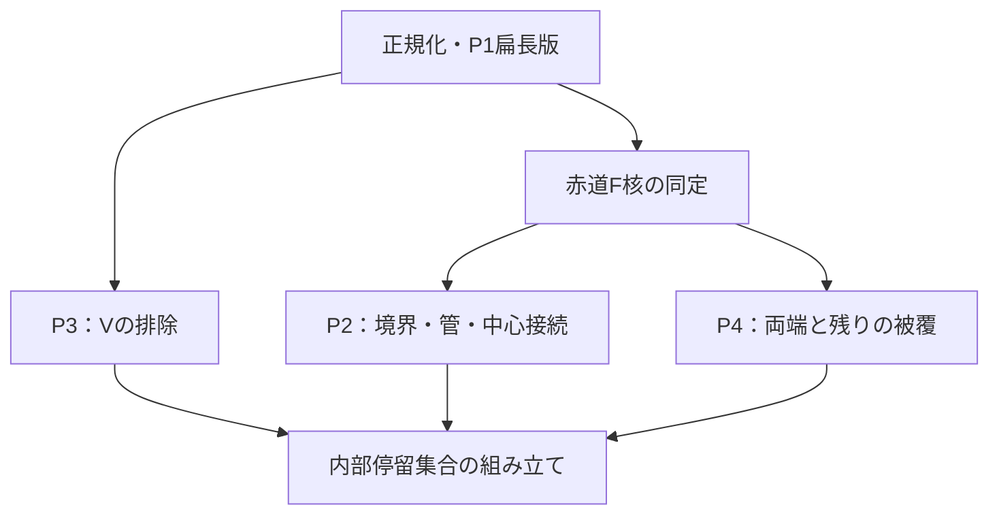

# D-PRO 大域定理の証明設計

2026-11-16／Judge依頼・Astra設計／**DESIGN_ONLY**

対象は λ∈[2,5]。本書は設計であり、新しい符号認証・本走・既存証拠の再検収を行っていない。実装はDig、独立検収はchat、採否はJudgeが担当する。数値診断は同梱の二値出力だけであり、証明ではない。GitHub・外部PCへの書込み、Actions起動は行っていない。

## 1. 主張

### 1.1 結論を先に

**P3は、D5の「連続な商＋領域被覆＋接触部分の絶対値評価」という型で設計できる。ただし、D5の数値定数や完成した認証を移すことはできない。** 推奨量は \(V=E_z/z\)。より強い条件 \(E_{zz}>0\) の全域認証は要求しない。

固定標本の二値診断は、Vの正値性についてtrue、E_zzの正値性についてfalseだった（§3.6）。前者は全域正値性の証明ではなく、後者も厳密な反例ではない。本設計の実効性を左右する未証明事項は、Vの境界面下界、商の区間幅、P2/P4の完全な外側被覆である。

**重要な非対称性：** 回転対称性から \(E_{yy}(\rho,0,z)=E_\rho/\rho\) は得られるが、\(E_{zz}(\rho,0,z)=E_z/z\) は得られない。したがって、横方向Hessian一つでHを評価する高速化をVへ置換してはならない。本書は反射差商を二次元のまま評価する新しい式を与える。

### 1.2 正規化と目標定理

参照楕円体を \(K_\lambda=\{x^2+y^2+z^2/\lambda^2\le1\}\) とする。既存の扁長側資料で回転軸をyと呼ぶ場合は、本書のzへ対応させる（y↔z）。以後、本書の座標に統一する。

\[
E_\lambda(p)=\frac1{4\pi\lambda}\int_{\partial K_\lambda}
\alpha^2(x,p)(x-p)\cdot\nu\,dA,
\quad F(r,\lambda)=E_x(r,0,0;\lambda).
\]

ここでrは赤道半径。三次元の楕円体半径は別記号Rを使い、
\[
a=\frac{1-\tau^2}{1+\tau^2},\quad b=\frac{2\tau}{1+\tau^2},\quad
p=(Ra,0,\lambda Rb),\quad 0\le R,\tau\le1.
\]
体積保存族は \(\lambda^{-1/3}K_\lambda\)。相似不変性から停留集合は \(p\mapsto\lambda^{-1/3}p\) で対応する。赤道円の物理半径は \(\lambda^{-1/3}r_*\) である。[S1 §1; S2 §2]

以下は**P3、P2、P4の義務をすべて満たしたときの目標**であり、今回得た定理ではない。\(\lambda_b=\lambda_\partial^{pro}\) と略す。

| λの区分 | 参照楕円体の内部停留集合 | 点の個数／回転群による軌道数 |
|---|---|---|
| [2,λ_b) | 原点 | 1／1 |
| {λ_b} | 原点。r=1の零点は内部に含めない | 1／1 |
| (λ_b,a_c) | 原点と \(\{(r_*\cos\theta,r_*\sin\theta,0)\}\) | 無限個／2 |
| {a_c} | 原点。停留円は半径0へ収縮 | 1／1 |
| (a_c,5] | 原点 | 1／1 |

「中心と円一つ」を「停留点2個」と数えない。a_cでの退化中心は一つの点である。

### 1.3 既存入力の射程

Item 0の採用済み主張は \(1<\lambda<\lambda_b,0<r<1\) でF>0。共通箱[1,206539/100000]全体でF>0という意味ではない。[S5 Theorem, Certified assembly]

局所係数は \(Q=E_{xx}(0)\)、\(H_4=E_{xxxx}(0)\) で、Qの単純零点とH_4<0が既存入力。軸方向 \(Q_z=E_{zz}(0)>0\) の記録は[47/10,19/4]に限られる。[S6 Definitions; S7 qz_integrand] Julia第二系統のJudge承認待ちは依頼書の状態を引き継ぐ。

B-TUBE v2.1は自己試験・契約であり、本走の数学的結論ではない。λ=118/25の単一スライスも枝全体を覆わない。[S8 Intended theorem interface, Cross-item MATCH dependency]

## 2. DAG（工程の依存関係）

P3の内部依存は、(i)正則性・差商、(ii)中心／一般域／境界面の独立な符号義務、(iii)境界面の正の下界→解析的薄層、(iv)一般域と薄層をつなぐ厚いカラー、(v)有理被覆である。境界面の余裕が未取得の間は、薄層幅を既存D5の値で固定しない。

P2の内部依存は、核同定→境界アンカーと中心局所モデル→中間管→両側外部排除→JOIN/MATCH。外部排除は管の存在・一意性とは別の必須ノードである。

工程ごとに契約・上流ピン・予算を事前宣言し、監査・FREEZE・実行許可・二系統検収を経る。本書の数値例は将来契約の候補であり、実行承認ではない。

## 3. P3：赤道面の外の排除

### 3.1 P1の扁長版：定数を作り直す

\(\xi=(\sqrt{1-\mu^2}\cos\phi,\sqrt{1-\mu^2}\sin\phi,\mu)\)、\(x=L\xi\)、\(L=\operatorname{diag}(1,1,\lambda)\)。P1の記号を保ち、
\[
w^2=\lambda^2(1-\mu^2)+\mu^2,\quad
\nu=(\lambda\xi_x,\lambda\xi_y,\mu)/w,\quad dA=w\,d\Omega,
\]
\[
D=|x-p|,\quad h=\lambda(1-\rho\xi_x)-z\mu,
\quad\gamma=h/(wD),\quad G(\gamma)=\arccos^2\gamma,\quad
\mathcal R(\gamma)=\frac{\arccos\gamma}{\sqrt{1-\gamma^2}}.
\]
密度を \(\mathcal F=hG\) と書く。赤道微分Fと混同しない。E=\((4\pi\lambda)^{-1}\int\mathcal F\,d\Omega\)。

λ∈[2,5]では \(1\le w\le\lambda\le5\)、\(D\le10\)、\(0\le h\le wD\)。P1のw≤1、面積≤4π、h≤Dは移植しない。代わりに、任意の単位方向e,fについて
\[
|\mathcal F_e|\le wC_1,\qquad
|\mathcal F_{ef}|\le\frac{wC_2}{D},\quad
C_1=\pi^2/4+2\pi,\quad C_2=9\pi+8<37. \tag{3.1}
\]
証明はP1 Lemma 3.3–3.4の計算で、各項のwを残すだけである。Gと\(\mathcal R\)はγ=1で正則、\(1\le\mathcal R\le\pi/2\)、\(-1\le\mathcal R'\le0\)。[S3 §§2–3]

凸曲面の局所面積評価 \(\operatorname{area}(\partial K\cap B(p,s))\le4\pi s^2\) はそのまま有効。全面積は≤100πへ変更する。任意の部分集合Aについて
\[
\int_A\frac{dA(x)}{|x-p|}\le2\sqrt{4\pi\operatorname{area}(A)}.
\]
(3.1)と \(d\Omega=dA/w\) により二階密度は一様可積分。固定球面上ではw≤5なのでλも含めて同じVitaliの議論が通り、Eの二階までの内部微分は閉包へ連続に延びる。内部ではC^∞。これはP1 Lemma Vの**新しい範囲への解析的拡張**であり、旧認証の範囲拡張ではない。境界までC³や外部へのWhitney拡張は主張しない。[S3 §§4–5]

### 3.2 Lemma 6.1／6.2の対応版

**補題P3-V（新規、証明付き）。** \(M_\lambda=\{\rho\ge0,\rho^2+z^2/\lambda^2\le1\}\) 上で
\[
E(\rho,-z)=E(\rho,z),\quad E_z(\rho,0)=0,
\]
\[
E_z(\rho,z)=\int_0^z E_{zz}(\rho,s)\,ds,
\quad V(\rho,z)=\int_0^1 E_{zz}(\rho,tz)\,dt. \tag{3.2}
\]
Vは連続、z≠0でE_z/z、z=0でE_zz。さらにVはρ、zそれぞれについて偶関数である。

*証明。* 赤道反射はKを保つのでEはzについて偶、E_zは奇。ρ反射は軸回りの半回転による。縦線分(ρ,s), |s|≤|z|はK内にあるので、内部で微積分学の基本定理を適用する。境界端は§3.1の連続延長による極限で処理する。赤道境界点では線分が一点へ退化し、V=E_zzと定義する。一様連続性と(3.2)からVの連続性、反射から偶性を得る。□

したがって \(V>0\) が正の子午面全域で示されれば、z≠0では \(E_z=zV\ne0\)。**ρ=0,z≠0も同時に排除され、軸上のC系の数え上げは不要**となる。実際の排除に必要なのはz≠0での非零性だけだが、閉領域でのV>0を認証できれば接続が簡潔になる。

### 3.3 E_z・E_zzの正確な核

P1記号で \(h_z=-\mu\)、\(D_z=(z-\lambda\mu)/D\)、
\[
\gamma_z=\frac{-\mu}{wD}-\gamma\frac{D_z}{D},
\quad D_{zz}=\frac{1-D_z^2}{D},
\]
\[
\gamma_{zz}=\frac{\mu D_z}{wD^2}
-\frac{\gamma_zD_z}{D}-\frac{\gamma D_{zz}}D
+\frac{\gamma D_z^2}{D^2}.
\]
従って
\[
\mathcal F_z=-\mu G-2h\mathcal R\gamma_z,
\qquad
\mathcal F_{zz}=4\mu\mathcal R\gamma_z
-2h\mathcal R'\gamma_z^2-2h\mathcal R\gamma_{zz}, \tag{3.3}
\]
それぞれの積分を4πλで割ればE_z,E_zzとなる。

相殺後の同値式も使える。\(T=(\lambda\mu-z)/D\)、\(n=\mu/w\)、\(e=\gamma T-n\) とおくと
\[
\boxed{\mathcal F_{zz}=\frac{2w}{D}
\{\gamma^2\mathcal R(1-T^2)-(2\mathcal R+\gamma\mathcal R')e^2\}.} \tag{3.4}
\]
γの**二乗**を落とさない。(3.3)に \(\gamma_z=e/D\)、\(\gamma_{zz}=(-\gamma+3\gamma T^2-2nT)/D^2\) を代入して展開すれば(3.4)。正負項が共存し、点ごとの非負性は前提にできない。微分は固定された境界点xで行い、その後に接触点中心座標へ変換する。

### 3.4 Vを二次元のまま扱う反射差商

同じ境界点xに対して
\[
K_V(x;\rho,z)=\frac{\mathcal F_z(x;\rho,z)-\mathcal F_z(x;\rho,-z)}{2z},
\quad K_V(x;\rho,0)=\mathcal F_{zz}(x;\rho,0), \tag{3.5}
\]
\[
V=(4\pi\lambda)^{-1}\int K_V\,d\Omega.
\]
恒等式はE_zの奇性から従う。K_V自体は縦線分に沿う\(\mathcal F_{zz}\)の平均である。

zが十分離れた箱では直接差商でよい。候補の切替はz_lo≥1/8を直接商、z_hi≤1/4を相殺商とし、重なる場合の優先順を契約に固定する。いずれでもない箱は二分する。z=0に触れる箱の初期案は\(\mathcal F_{zz}\)の線分上の包絡だが、包絡を取ってから積分すると負の部分を過大評価しうる。**主実装は以下の相殺した差商演算**とする。

\(A_\pm=A(\pm z)\)、\(\bar A=(A_++A_-)/2\)、\(\delta A=(A_+-A_-)/(2z)\) を形式的に定義する。
\[
\delta(AB)=\bar A\delta B+\bar B\delta A,\qquad
\delta(A^{-1})=-\delta A/(A_+A_-),
\]
\[
\delta h=-\mu,\quad \delta D^2=-2\lambda\mu,\quad
\delta D=-2\lambda\mu/(D_++D_-),\quad\delta z=1. \tag{3.6}
\]
\(\gamma=h/(wD)\)、\(\gamma_z=-\mu/(wD)-h(z-\lambda\mu)/(wD^3)\) をこの演算で評価し、
\[
K_V=-\mu\,G[\gamma_+,\gamma_-],\delta\gamma
-2\delta(h\mathcal R(\gamma)\gamma_z). \tag{3.7}
\]
角括弧は連続延長を含む一階差商。これで分母zが消える。z=0で(3.3)に一致する。区間の中点を真値の代わりに使わない。

**差商を追加の積分変数なしに評価する新補題。**
\[
\mathcal R(\gamma)=\int_0^\infty\frac{dt}{\gamma+\cosh t}
=\sum_{n=0}^\infty c_n q^n,\quad q=1-\gamma\in[0,1],
\]
\[
c_n=\frac{2^n(n!)^2}{(2n+1)!},\quad c_0=1,\quad
c_{n+1}/c_n=(n+1)/(2n+3)<1/2. \tag{3.8}
\]
*証明。* tの積分にv=tanh(t/2)を代入して初式を得る。\((1+\cosh t-q)^{-1}\) を非負級数に展開しTonelliを適用する。係数積分は同じ置換とBeta積分で上式。比率よりq∈[0,1]で微分級数まで一様収束する。□

\(S_n(x,y)=\sum_{j=0}^{n-1}x^jy^{n-1-j}\) とすると
\[
\mathcal R[\gamma_+,\gamma_-]=-
\sum_{n=1}^\infty c_n S_n(q_+,q_-),\quad
G[\gamma_+,\gamma_-]=-2\sum_{n=0}^\infty\frac{c_n}{n+1}S_{n+1}(q_+,q_-). \tag{3.9}
\]
q_+=q_-でも同じ多項式。差商の二つの値を別々に計算して引かない。N次までの打切りの絶対尾部は順に \((2N+4)c_{N+1}\)、\(4c_{N+1}\) 以下で、どちらも剰余の符号は負。Rそのものの尾部は[0,2c_{N+1}]。導出は \(S_n\le n\) と幾何級数。

微分用尾部も、例えばqに関する総次数kの微分を \((n+1)^{k+1}\) で粗く抑え、\(c_{N+1}\sum_{j\ge0}(N+2+j)^{k+1}2^{-j}\) という**厳密な有理上界**で囲める。これはk次多項式の幾何モーメントから有限計算できる。N=96を初期契約候補とする根拠はこの比率であり、診断の値ではない。

実装は \(S_1=1,\ S_{n+1}=q_+S_n+q_-^n\) を使えば、除算なし・次数Nに比例する演算で評価できる。正確な核→差商の代数変形→区間評価の順を守る。checkerは(3.3)を独立転記し、(3.4)・(3.7)との記号同一性を確認する。境界接触でD_+またはD_-が0を含むセルは次節のcutへ回す。

### 3.5 接触部分・境界面・定量的な薄層

**球面測度での一様cut補題（新規）。** 球面上の固定可測集合Aの面積をMとする。λ≥1で \(D\ge|\xi-L^{-1}p|\)、w/λ≤1なので、(3.1)と球面の面積成長評価から
\[
\frac1{4\pi\lambda}\int_A|\mathcal F_{zz}|\,d\Omega
\le C_2\sqrt{M/\pi}<37\sqrt{M/\pi}. \tag{3.10}
\]
(3.5)の線分平均へTonelliを適用すればK_Vにも同じ上界が成立する。従って球冠 \(1-\xi\cdot Q<\kappa\) 一個なら損失≤\(37\sqrt{2\kappa}\)。反射側も切るときは**和集合の面積**を上から囲み、一度だけ支払う。二冠の面積を足す保守上界なら≤4πκで損失≤74√κ。D5の45√κを引用して流用しない。

z≥z_0>0では第一微分の有界性による別上界 \(C_1M/(4\pi z_0)\) も有効。二つの有効な上界の小さい方を採る規則を事前に固定できる。cut集合は外箱全体の全パラメータに共通にし、正則セルと重複・欠落なく分割する。

**Hessianの連続率（新規、保守的）。** λ固定、p,p'∈K、\(\eta=|p-p'|\le s\le1\) とする。任意の単位eについて
\[
|E_{ee}(p)-E_{ee}(p')|
\le148s+600\eta\{1+2\log(10/s)\}. \tag{3.11}
\]
*証明の詳細。* \(k=\mathcal F_{ee}/w\) は|k|≤37/D。(3.8)の積分から \(|\mathcal R''|\le\pi/2\)。逆距離の一・二・三階微分をそれぞれ \(D^{-2},4D^{-3},24D^{-4}\) で抑えると、\(|\gamma_e|\le2/D\)、\(|\gamma_{ef}|\le5/D^2\)、\(|\gamma_{eef}|\le36/D^3\)。\(k=-4(h_e/w)\mathcal R\gamma_e-2(h/w)\mathcal R'\gamma_e^2-2(h/w)\mathcal R\gamma_{ee}\) をf方向に微分し、項別評価すると
\[
|\partial_fk|\le(84+59\pi)/D^2<300/D^2.
\]
A=\(\partial K\cap B(p,2s)\) の面積は≤16πs²。A上のp,p'双方の|k|積分の和は≤32π·37s。Aの外ではpからp'への線分上の距離はD(x,p)/2以上なので差は≤1200η/D(x,p)²。全面積≤100π、D≤10と層積分から
\(\int_{D\ge2s}D^{-2}dA\le4\pi+8\pi\log(10/s)\)。4πλ≥8πで割ると(3.11)。境界接触点は零測度であり、必要な極限は一様可積分性から取れる。□

これは境界で一様な三階微分を主張していない。積分前に接触近傍を分けた連続率である。

境界点 \(p_1=(a,0,\lambda b)\)、内部点 \(p_R=(Ra,0,\lambda Rb)\) について、(3.2)の各縦線分点の差は≤5d、d=1−R。従って
\[
|V(p_R)-V(p_1)|\le148s+3000d\{1+2\log(10/s)\},\quad5d\le s. \tag{3.12}
\]
**境界面で将来得る厳密下界m>0**を入力とし、正の有理数s≤min(1,m/592)と整数Nで2^N≥10/sを選ぶ。log2<1より
\[
\boxed{\varepsilon=\min\{s/5,\ m/[12000(1+2N)]\}>0} \tag{3.13}
\]
は有理数で、R∈[1−ε,1]にV≥m/2を与える。mは未取得。本式で具体的幅を作れることと、今回その幅が得られたことを区別する。幅が小さすぎる場合は、(3.4)の構造を使った連続率の鋭化か、厚いカラーの追加が必要。

### 3.6 診断の結果と解釈

同梱PLAN_BEFORE_RUN.mdをスクリプトとともにハッシュ固定してから実行した。対象はλ両端、a_cを囲む有理数、既存スライス、中心・極・赤道・境界・境界近傍を含む固定標本。接触点中心の二つの固定求積設定で、二値の結果だけを保存した。

| 事前固定の問い | DIAGNOSTIC_ONLY |
|---|---|
| 全固定標本で両設定ともV>0を返すか | true |
| 全固定標本で両設定ともE_zz>0を返すか | false |

全域V>0、真の負値、停留円そのもののE_zz符号は、この出力から確定しない。特に既知スライスの根区間内の固定点は根そのものではない。停留円上の横断正値性は、将来の根の管全体でV(ρ,0)=E_zzを認証する。中心Q_zの既存の正値性はa_c周辺だけの厳密な手がかりである。

数値の値・余裕・最悪点・符号変化点を保存または設計へ利用していない。falseを理由に局所分割位置を選んでいない。推奨するV方式は(3.2)の論理と(3.5)–(3.10)の収束可能性に基づく。

### 3.7 D5領域分割の移植と実装インターフェース

| 領域 | 移植方法 | 新しく必要なもの |
|---|---|---|
| 中心R≤1/8（候補） | 中心展開と四階上界 | Q_z>0をλ∈[2,5]全体へ認証 |
| 一般域[1/8,15/16] | V差商の二次元区間積分 | (3.7)のjet、正確な外箱被覆 |
| 厚いカラー[15/16,1−ε/2] | 接触点中心座標・d/uの帯分割 | prolateの尺度、反射した二接触点の処理 |
| 薄層[1−ε,1] | 境界mと(3.13) | mの厳密な証明書 |
| 外側面R=1 | Vの連続延長核を直接認証 | τ=0の差商極限、τ=1の軸極限 |
| 極corner | まず同じcut法で覆う | 必要時のみ専用補題。旧FT_qは流用しない |

中心では反射と二回のTaylor積分から、\(|E_{xxzz}|\le M_x\)、\(|E_{zzzz}|\le M_z\) が中心領域で成り立つなら
\[
V(\rho,z)\ge Q_z(\lambda)-\tfrac12M_x\rho^2-\tfrac16M_z z^2. \tag{3.14}
\]
まずρ方向にE_zzを展開し、次に軸上のz方向に展開してtを積分すればよい。中心R≤1/8ではD≥7/8（λ≥1）なので、四階微分の有界性は接触問題を伴わない。既存Q_zの範囲外では新しい一次元係数認証が必要。

全方式で真の基点はR,τ,λの写像内に保つ。外接する独立なρ,z区間の全点がK内にあると誤認せず、γ∈[0,1]との交差は真の基点についての幾何補題に基づいて行う。

厚いカラーは \(q=1-\xi\cdot Q=8u^2/(1+u^2)^2\)、\(u=\tan(\psi/4)\)、
\[
|\xi-RQ|^2=d^2+2Rq,\qquad h=\lambda(d+Rq)
\]
を同時に保持する。正のdyadic帯d∈[D,2D],u∈[U,2U]ごとに固定尺度ℓ=max(D,U)を使う。D物理距離との記号衝突を避け、実装では帯下端をd_loと呼ぶ。λ≥1ゆえ物理距離≥球面側距離であり、尺度で割った分母は少なくとも一方の規格化変数が1以上になることで抑えられる。反射点を含む二つの接触域を扱い、各セルの所有者とcutの和集合を厳密に記録する。

角度の幅が広い帯へも同じ少数セルだけを割り当てない。例えばuのセル幅≤1/32を非接触側の初期候補とし、近接側は尺度ごとの分割を併用する。これは幾何的な幅の規則であり、今回診断の観測値から選んでいない。

極ではz≈λで商の分母は消えず、ρ=0でφ積分が消える。**扁平のFT_qと同型の極corner補題が必須だとはいえない。** 一方、赤道と外側面の交点ではz→0と接触が重なるので、ここが新しい主要な角である。(3.7),(3.10)で覆えないときだけ、z・d・接触角を保った専用blow-upを作る。角を未認証のまま除外しない。

正則セル上では、変換後の完全密度kについて二変数逐次中点の下界
\[
\int_C k\ge ab\,k(m_u,m_v)^-
+\frac{a^3b}{24}(k_{uu}|_C)^-
+\frac{ab^3}{24}(k_{vv}|_{u=m_u})^-
\tag{3.15}
\]
を使用できる（a,bはセル幅）。一次元中点のPeano表示をu、次にvへ適用する証明であり、二階項は符号付き。ヤコビアンも微分に含め、外側R,τ,λは普遍区間のまま扱う。微分係数のjet係数と真の二階微分の2!を区別する。正規化4πλは最後に区間演算で掛け、正負に応じた下端を取る。cut損失と級数剰余を二重計上・脱落させない。

区間幅が収束する独立二系統実装を条件とすれば、連続なVが閉領域で厳密に正である場合、正則部分の細分と(3.10)のcut縮小により有限被覆が存在する。単純な線分Hessian包絡だけはこの収束を保証しないので、実装の唯一の方式にはしない。

### 3.8 Vが一様な符号を持たない場合

第一代替は、子午面の各箱で「0∉V」または「ρ>0かつ0∉H=E_ρ/ρ」を示す混合被覆。z=0へ触れる箱はVの連続延長を使い、ρ=0の箱でE_ρを排除成分に使わない。連続なVの零集合を横切る場所では、もう一方の成分が非零なら十分である。

第二代替は \(X=\rho^2,Y=z^2\) による内部の滑らかな商(H,V)を用い、候補零集合を二次元区間Newton/Krawczykと外側の成分符号で処理する。ρ,z>0の同時零点は赤道外の停留円を生むため、見つかった場合は目標定理自体の修正対象である。次数や境界windingが0だけでは相殺する根対を除けない。

第三代替は、既存の赤道円の近傍をP2の管とV>0で保護し、その補集合のみ混合被覆する方法。追加の赤道外枝の可能性が残るならλ管追跡に移るが、管の外側排除と分岐点の局所解析を必ず伴わせる。分割位置は解析式または新規の厳密認証から決め、今回の診断の内部値を使わない。

## 4. P2：停留円の枝 λ_b→a_c

### 4.1 同じFであることを固定する

赤道ではz=0、μの反射で球面を半分にできるので、P1式は
\[
E_\lambda(r)=\frac1{2\pi}\int_0^{\pi/2}\int_0^{2\pi}
(1-r u)G(\gamma)\sin\theta\,d\phi d\theta,
\quad u=\sin\theta\cos\phi,
\]
\[
\gamma=\lambda(1-ru)/(w\sqrt{\ell-2ru+r^2}),\quad
\ell=\sin^2\theta+\lambda^2\cos^2\theta
\]
となる。これはclean-room実装の定義式と一致する。[S9 module docstring, _F_kernel, _dFdr_kernel] 半球係数1/(2π)と、φ∈[0,π]へ縮めた後の1/πを区別する。

clean-room核は歴史的核ef065381…の復元ではない。[S10] 回帰試験・記号監査・来歴の確認を入力鎖に残す。今回ソースは読んだがCI結果や元ZIP全葉の再実行はしていない。既存の認証結果を引用することと、新核の実装を独立検証することを分ける。

### 4.2 境界からの入口

\(B_{pro}(\lambda)=F(1,\lambda)\) とする。§3.1の二階連続延長は、FとF_rのr→1極限・一側微分を正当化する。Bのλ微分には、移動する楕円体を球面へ引き戻した核で別途微分・可積分性を確認する。旧B_obの核・符号は使わない。

境界帯r∈[r_b,1]、λ∈[2,λ_s]で次を証明する設計とする。
\[
F_r\le-m_r<0,\qquad F(r_b,\lambda)>0,
\quad B'_{pro}<0,
\]
\[
B_{pro}(\lambda_b)=0,\quad
B_{pro}>0\ (\lambda<\lambda_b),\quad
B_{pro}<0\ (\lambda>\lambda_b). \tag{4.1}
\]
初期候補はr_b=3/4、λ_s=21/10。既存Item 0bの範囲外(206539/100000,21/10]は新規義務であり、成功を仮定しない。B'の全帯符号が得られなければ、既存の一意根の局所帯と外側B符号の被覆へ分ける。

*帰結の証明。* Fの狭義減少と左壁の正値より、λ≤λ_bでは内部根0、λ>λ_bでは帯内根1。λ=λ_bではr=1だけが閉帯内の根であり、内点ではない。根r_*について \(-B_{pro}(\lambda)\ge m_r(1-r_*)\) なので、λ↓λ_bでr_*→1。入口をあらかじめ仮定せず、この議論で同定する。[比較：S11 §6]

赤道の残り(0,r_b]は、λ∈[2,λ_s]で中心係数＋Fの正値被覆を別に証明する。境界帯だけで全赤道を数えない。

### 4.3 中間の管と外側排除

推奨コアは[λ_s,118/25]（λ_s=21/10は候補）。有理slab Λごとに厳密な管r_−(λ)≤r≤r_+(λ)を置き、
\[
F(r_-,\lambda)>0,\quad F(r_+,\lambda)<0,\quad
\sup_TF_r<0. \tag{4.2}
\]
中間値と単調性で、各λに管内根がちょうど一つ。B-TUBE v2.1のparametric Krawczyk strict inclusionを存在ゲートとして併用する場合も、F_r<0と両壁を残す。例として固定中心m・非零有理前処理Cによる
\(K=m-CF(m,\Lambda)+(1-CF_r(I,\Lambda))(I-m)\subset\operatorname{int}I\)
を用い、全パラメータを区間で囲む。

各slabで(0,r_−)のF>0、(r_+,1]のF<0を**完全に覆う**。原点側はF/r、境界側は§3.5の接触処理を使う。符号付き平均値の門は、上界U_seed<0と各帯のF_r上界U_jから
\[
U_{seed}+\sum_j\Delta r_j\max(0,U_j)<0 \tag{4.3}
\]
なら右方向全体でF<0を保証する。左側の正値には下界L_seedと \(\sum\Delta r_j\min(0,L_j)\) を使う。逆向きに走る場合は積分の向きも反転させる。全slab幅を含む同じ普遍λ箱で門を成立させる。[S12 §§4–5; S13 §4]

隣接管の接点λ_iで、**実際の交差区間**J_iが正の幅を持ち、J_i上のKrawczyk包含を確認して同一根を同定する。単なる管の重なりは同一根の証明にしない。[S8 JOIN and boundary semantics] 先頭は境界帯、末尾はitem3の固定スライスへ同じ操作で接続する。

### 4.4 中心への接続

\[
E(r,0)=E(0)+Q(\lambda)r^2/2+H_4(\lambda)r^4/24+O(r^6),
\quad\Phi(s,\lambda)=F(\sqrt{s},\lambda)/\sqrt{s},
\]
\[
\Phi(0,\lambda)=Q(\lambda),\quad
\Phi_s(0,\lambda)=H_4(\lambda)/6. \tag{4.4}
\]
Fの奇性と内部C^∞性によりΦはs≥0で滑らかに延長する。候補はλ∈[118/25,19/4]、r∈[0,r_c]、r_c=1/16。既存の単一スライス根区間(1/64,11/256)を内側に含む合理的な候補であり、成立済みとはしない。

新しい定量ゲートは
\[
\Phi_s\le-\eta<0,\quad\Phi(r_c^2,\lambda)<0,
\quad Q'(\lambda)<0,\quad Q(a_c)=0. \tag{4.5}
\]
最初のゲートはF'''=E_xxxx≤−6ηをr∈[0,r_c]で証明すれば足りる。実際、F''(0)=0より
\[
\Phi_s=\tfrac12\int_0^1\!t^2\int_0^1 F'''(utr,\lambda)\,du\,dt.
\]
あるいは六階上界M_6により \(F'''(r)\le H_4+M_6r_c^2/2\) とする。既存のH_4<0という点係数だけでは有限幅r_cのゲートを得たことにならない。

λ<a_cではQ>0なのでs∈(0,r_c²)に一意根、λ≥a_cではQ≤0なのでr>0でF<0。a_cでも \(\Phi(s)<\Phi(0)=0\) により追加根はない。根は \(r_*^2\le Q/\eta\) からa_cへ近づくと0へ収縮する。既存スライスと同じ根だとMATCHするには、同じλ=118/25で包含・核同一性・証拠SHAを照合する。

残るr∈[r_c,1]、λ∈[118/25,19/4]はF<0の被覆が別途必要。局所陰関数定理や単一スライスをこの外側排除の代用にしない。

### 4.5 再利用の線引き

| 既存部品 | 再利用するもの | 作り直す／確認するもの |
|---|---|---|
| Item 0 | 採用済み範囲の符号・界面 | 原本未収録分の来歴ピン、入口を越える箱 |
| B-LOCAL | Q,Q',H_4の符号とa_cの定義 | 有限幅局所剰余、Julia採用状態 |
| B-TUBE v2.1 | dyadic・台帳・JOIN・精度規則 | mockを実核へ交換し独立監査、本走と外側被覆 |
| clean-room F,F_r | 正確な定義式と来歴 | 独立checker核、現在の依存関係・回帰証拠 |
| item3 F_rr | 奇性によるF/r、F_rr式 | F'''または六階剰余、λ全帯の接続 |
| λ=118/25スライス | 固定界面と根区間 | 実ZIPの取得・SHA・単一スライスの射程確認 |

item2旧READMEのλ∈[5,6]パイロットやλ=100までの計画は今回の枝範囲と整合しない。clean-room READMEも旧[5,6]は別件と明記している。[S10; S14] 固定する範囲は新契約の[λ_s,118/25]とする。item3の旧calibration JSONのfloatによるsign_certifiedは証明ノードにしない。[S15]

## 5. P4：両端と残りの赤道被覆

### 5.1 λ=2と入口ちょうど

2<λ_bは既存入力なので、λ=2はItem 0の厳密な適用範囲内。P3のλ箱も左端2を閉じて含める。λ=1を含む有限箱というだけで、λ=1でF>0と主張する必要はない。

λ=λ_bはItem 0の定理の厳密不等号から直接は出ない。しかし0c,0d,0bの閉箱はλ_bを含む。0bのF_r<0とF(1,λ_b)=0よりr<1ではF(r,λ_b)>0。0c/0dと接続すれば全赤道の内部根0が従う。この端点論証には、新たな浮動近似の閾値を導入しない。[S5]

### 5.2 λ∈[a_c,5]の正しい符号

狙う符号は **F<0**。Q'(a_c)<0、H_4(a_c)<0より、a_cでは \(F(r,a_c)=(H_4(a_c)/6)r^3+O(r^5)<0\) が小さいr>0で成立する。従ってこの範囲でF>0という設計は中心局所モデルと矛盾する。

λ∈[a_c,19/4]は§4.4の中心部とその外側F<0被覆を使う。λ∈[19/4,5]では、Q<0の一次元係数認証＋中心剰余、r∈[r_c,1]のF<0被覆を新設する。Q'<0が[47/10,19/4]で成立することを5まで外挿しない。

境界のF(1,λ)<0は新しいB_proの範囲別認証、または赤道境界帯の直接評価で処理する。中心からの負のseedと(4.3)による累積門で覆える部分は、Fそのものの細分を節約できる。r=0はF=0が恒等的なのでF<0ゲートへ入れず、F/rまたはΦを使う。

λ=5を最後の閉slabの端として含める。計算の最後のλ値が5に近いだけでは不十分。λ_bとa_cを囲む有理区間の内部は、(4.1),(4.5)の**根で定義されたパラメータ**による論証が担当し、区間幅を未処理の穴として残さない。

## 6. 組み立て

**G1-pro。** P3よりz≠0の内点でE_z≠0。回転と反射で全空間に戻し、内部停留集合は赤道面に含まれる。これは軸上ρ=0,z≠0も含めて排除する。

**G2-pro。** 赤道面では反射からE_z=0。r>0で回転不変性から
\[
\nabla E(r\cos\theta,r\sin\theta,0)
=F(r,\lambda)(\cos\theta,\sin\theta,0).
\]
よって正の赤道根一個は停留円一個に対応する。原点は全反射から常に停留点。

**G3-pro。** Item 0＋入口端点論証、P2の境界帯・中間管・中心帯と各外側被覆、P4のa_c以後の負値被覆を結合し、正の内部赤道根数を0,1,0とする。そこから§1の表を得る。

**G4-pro。** 正の相似でEは不変。勾配は相似率の逆数倍なので零点が保存され、体積保存族へ移る。[S1 §1; S2 §2]

被覆台帳には各閉箱、用途（排除／根管／界面）、所有者、上下流SHAを持たせる。共有端点は重なりを許すが、根を二重に数えない。外側R被覆は中心→一般→厚層→薄層、赤道λ被覆はItem 0→入口帯→管→中心帯→後半とし、**二種類の被覆を別々に厳密分数で検査**する。台帳の面積一致だけで点ごとの被覆を代用しない。

## 7. 解析補題の一覧

| 補題／入力 | 現状と移植 | 新たな証明・機械義務 |
|---|---|---|
| 相似不変性 | 定義からそのまま移植 | G4の座標同定 |
| 内部C^∞、二階閉包連続 | P1の論法は移植可能 | wと全面積を直した§3.1の監査 |
| 反射・V連続延長 | P1 Lemmas 6.1–6.2の役割交換 | §3.2の証明を採否判断 |
| E_z,E_zz核 | P1一般方向式から導出 | (3.3)–(3.4)の独立式照合 |
| 安定V差商・角度差商 | 新規(3.6)–(3.9) | 有理尾部とjetの監査 |
| cutの一様可積分性 | P1面積成長を移植 | prolate定数(3.10)、和集合処理 |
| 薄層の定量延長 | 新規(3.11)–(3.13) | 境界m>0の新規認証 |
| 中心Q_z、四階剰余 | 既存Q_zは局所λ帯のみ | 全λ帯の係数と(3.14) |
| 赤道Fの正規化同定 | clean-room定義式と一致 | 独立checker・来歴ピン |
| 境界入口 | 扁平bandの論証を符号反転して移植 | B_proとF_r、左壁、外側被覆 |
| 管・JOIN・外側排除 | C1b/B-TUBE契約を再利用 | 本物のF核で全slabを計算 |
| 中心分岐 | Q,Q',H_4は既存入力 | Φ_sと有限幅・外側被覆 |
| 平均値累積門 | C系の論証をそのまま移植 | F_r上界／下界の新規台帳 |
| λ∈[a_c,5] | 局所符号から方針決定 | Q<0とF<0の完全被覆 |
| 大域組み立て | D-OBのG1/G2を変更 | 点数と回転軌道数を区別 |

核の数学的正しさ、区間包絡の正しさ、実際の符号の三つを別の監査対象とする。形式的な補題の移植だけで数値符号まで移植したことにしない。

## 8. 計算量と工程の日数の見積もり

### 8.1 設計上の規模

Ryzen 9 9900Xの12物理コア、GPUなし、python-flintを前提とする。CPU計測は今回行っていない。以下は**仮定を明示した予算モデル**であり、診断結果や扁平の所要時間からの実測予測ではない。

- P3初期外箱：R8×τ16×λ24＝3,072。中心・面は別ノード。各正則積分の初期32×32セル、接触部は固定cutと有理帯分割。
- 将来のP3契約候補：外箱上限200,000、各積分セル上限65,536。再試行を含む総評価上限も別に宣言し、積だけの巨大な上限を現実的予算と呼ばない。
- P2コア[21/10,118/25]を初期幅≤1/64で切ると168slab。受理上限2,048、試行上限4,096を候補とし、管・壁・両側外部をすべて含める。
- P4初期24λ帯×32r帯＝768箱（中心は別）。境界・局所接続も別計上する。
- producer160bits/checker192bits、R差商級数N=96は初期候補。幅の改善に必要な精度・Nの段階変更は事前宣言する。

### 8.2 CPU時間のシナリオ

\(N_B\)=受理外箱数、\(N_C\)=平均内側セル数、t=一セルの完全な核・必要jet評価の単一コア秒。二系統係数を2.5、失敗試行係数を2と**仮定**して
\[
T_{CPU}=5N_BN_Ct,\qquad T_{wall}=T_{CPU}/(12\cdot0.75).
\]
係数2.5も稼働率0.75も未測定。並列数24がそのまま24倍になるとは見込まない。

| P3の仮定ケース | N_B | N_C | t | 合計CPU時間 | 壁時計時間 |
|---|---:|---:|---:|---:|---:|
| 軽い場合 | 20,000 | 4,096 | 0.5ms | 約57 core-hour | 約6.3時間 |
| 中間予算 | 60,000 | 8,192 | 1ms | 約683 core-hour | 約3.2日 |
| 重い場合 | 200,000 | 16,384 | 2ms | 約9,102 core-hour | 約42日 |

これらは必要箱数の保証ではない。式(3.7)の差商jetが遅い、あるいは薄層が非常に薄い場合は重いケースを越える。単純な箱増加より、反射差商の相関保持と解析的cutの鋭化を優先する。

P2について一slabを壁・管・外側を合わせ64積分相当、各4,096セル、t=1msと**仮定**すれば、168slabで約61 core-hour／壁時計6.8時間、2,048slabで約746 core-hour／3.5日。中心・境界ノードを別に0.5–2日置く。P4の768箱×4,096セルを同じ条件で見積もると約4.4 core-hourであるが、接触と零点近接の細分を含まないため、工程上は0.5–2日の枠を確保する。

### 8.3 日数と着手順

数学・実装の初期監査2–4日、固定ベンチマークと契約確定1–2日、P3は中間予算3–5日、P2は1–4日、P4は0.5–2日、独立検収・組み立て2–4日を目安にする。独立ノードを並行させた計画幅は**約10–20日**。数学的障害が出ればこの幅は無効で、重いケースではP3単独42日以上になる。

最初に測るべきものは、事前固定した同じ幾何の箱に対する完全な核・jetの秒数とメモリ、厳密区間評価の成否である。これは将来の別較正工程であり、今回の二値診断から精度・分割を推定しない。正式走行前にDigが実測でtと予算を置き換える。失敗箱を捨てず、上限到達は未解決として次版へ戻す。

## 9. リスクと、代わりの方式

1. **V正値性は未証明。** 二値trueだけでP3を受理しない。境界または内部の厳密反例が得られたら§3.8の混合排除へ移る。同時零点なら目標表を再検討する。境界でV=0だが内部で正となる場合は、境界m>0からの薄層方式を使えない。境界距離で除した先頭項と符号付き剰余の専用補題、またはもう一方の勾配成分による排除が必要になる。
2. **E_zz単独の全域案は強すぎる。** Vは線分平均である。負の曲率があってもV正値性と矛盾しない。今回falseの位置を探し直して分割を選ぶことはしない。
3. **境界三階微分を要求しない。** 厚層の正則セルではjet、接触部分では(3.10)、最終薄層では(3.12)を使う。単なるC²連続性だけでは幅を決められない。
4. **薄層幅が小さい。** (3.13)は保守的。境界mが小さければ多くの深さ帯が必要。正確な相殺を使った第三階核の積分評価を次の数学的改善とする。
5. **P2の外側に未処理の根が残る。** 管内一意性・一スライス・JOINだけで全赤道の一意性を宣言しない。平均値門と完全被覆を必須にする。
6. **中心係数だけではa_c以後を覆えない。** λ方向もr方向も射程を限定する。Q'(a_c)<0を全[2,5]の単調性と読み替えない。
7. **来歴の不足。** 0cのREADMEは元ZIPが当該入庫時に添付されなかったと明記する。[S16] 依頼書の採用済み状態は入力として扱うが、今回元ZIPを再取得・再検収したとは記さない。新大域の上流台帳に採用記録・原本SHAを整備する。
8. **指定STATEと後続裁定の時点差。** 指定98e161…のSTATEはv1.61で、D-OB全体は組み立て待ちと記載。後続127be520…のV24裁定・監査が大域採用を記録する。矛盾を隠さず、D-OBの採用状態には後続裁定を引用する。[S0,S2]
9. **clean-roomの独立性。** 記号式の一致、歴史核との回帰、独立checkerの三つは別物。同じ実装を二回動かしただけで独立数学導出と呼ばない。新R級数を共用する場合も実装と尾部計算は別転記し相互照合する。

## 10. Judgeに判断してもらう点

| 判断 | 選択肢 | 推奨 |
|---|---|---|
| P3主方式 | V差商／E_zz全域／混合成分 | **V差商**。混合成分を代替として保持 |
| 初期実装の対象 | 全領域一斉／核・境界面・中心を先行 | **後者**。薄層mと全λのQ_zを先に確保 |
| P2コア方式 | 既存B-TUBE契約／壁と単調性のみ | **既存契約＋壁符号＋外側被覆**。自己試験を実核へ昇格する監査を必須化 |
| 中心の第二系統 | 既存Juliaの裁定待ち／別系統を新設 | **既存Juliaを優先して採否確定**。本書で承認を代行しない |
| 計算予算 | 未測定のまま本走／固定較正後に決定 | **固定較正後**。中間ケースを仮予算、重いケースは再設計の目安 |
| 来歴の不足 | 同じ値を再生成して原本扱い／元証拠をpin | **元証拠をpin**。欠損時は別版の再認証と明記 |

この表は次工程の選択肢であり、今回の納品を待機させる承認質問ではない。chatの一回の監査後、Judgeが実装工程へ採用する範囲を裁定する。

### 出典台帳（本文の[S番号]は以下のcommit・パス・節を指す）

同じSHAを繰り返さないため、リポジトリ／commitの略号を定義する。

- **OB** = `cotaxxxx/bg-oblate-spheroid` @ `e3f2c4974aa222bc076d706be885a346fca8f581`
- **OC** = 同 @ `59aed60305fca61fd63551f49fe9667ff1acfad4`
- **PRO** = `cotaxxxx/basepoint-geometry` @ `abf704b8701f3da8eb41d8a99408570a413b2214`
- **FV24** = `cotaxxxx/bg-spheroid-family` @ `127be52046e9498d1306fe3d35c3e02e91c636de`

| ID | リポジトリ／commit・パス | 節／読み取った射程 |
|---|---|---|
| S0 | `cotaxxxx/bg-spheroid-family` @ `98e161969a8f75e8cbd515c7639326cf99a40076`, `STATE.md` | 冒頭、§3–4。後続V24より前の状態 |
| S1 | 同 @ `9cdbf805df6ecf11bbaccfeb7babb7ed8e1d5f23`, `drafts/2026-11-16/D_OB_GLOBAL_ASSEMBLY_V0/D_OB_GLOBAL_STATIONARY_POINTS_ASSEMBLY_DRAFT_V0.md` | §§1–3、G1/G2、相似 |
| S2 | FV24, `runs/2026-11-16/D_OB_GLOBAL_CLOSED_V24/JUDGE_RULING_D_OB_GLOBAL_CLOSED_20261116.md` および同ディレクトリ `CHAT_AUDIT_C_V1_1_AND_D_OB_GLOBAL_V0_20261116.md` | 裁定「根拠」、監査§2 |
| S3 | OB, `analysis/D_OB_P1_DESIGN_NOTE.md` | §§1–8、Lemma V、6.1、6.2、§8.4 |
| S4 | OB, `analysis/D_OB_P2_CERTIFICATION_SPEC_V3.md` | §§0–7。歴史的仕様のP'と最終D5全域は区別 |
| S5 | PRO, `CERTIFICATES/prolate/ITEM0_THEOREM.md` と `CERTIFICATES/prolate/README.md` | Theorem／Certified assembly／Item 0 |
| S6 | PRO, `CERTIFICATES/prolate/local_bifurcation/README.md`、同 `prolate_cap_arb_certificate.py` | README局所係数、コードDefinitions／q_integrand／h4_integrand |
| S7 | PRO, `CERTIFICATES/prolate/local_bifurcation/prolate_Qz_arb_certificate.py` と同 `.json` | qz_integrand／proof_interval／conditions。Q_z=E_zzの式照合 |
| S8 | PRO, `CERTIFICATES/prolate/item2_circle/b_tube_v2_1/README.md` | Intended theorem interface、JOIN、MATCH、Precision invariant |
| S9 | PRO, `CERTIFICATES/prolate/item2_circle/vendor/prolate_circle_F_cleanroom.py` | PROVENANCE、_geometry、_F_kernel、_dFdr_kernel、_rigorous_integral_2d |
| S10 | PRO, `CERTIFICATES/prolate/item2_circle/cleanroom/README.md` | B-KERNEL clean-room audit全文 |
| S11 | OC, `analysis/LOCAL_ENTRY_BAND_JUDGE_REQUEST.md`、`analysis/BOB_ENDPOINT_RECERTIFICATION_MACHINE_RECEIPT.md` | 前者§§3–7、後者§§1–2、境界の帰着と条件の区別 |
| S12 | OC, `analysis/GLOBAL_AXIAL_C1_CROSSING_TUBE_CONTRACT.md`、`analysis/GLOBAL_AXIAL_C1B_MACHINE_RECEIPT.md` | 契約§§4–8、受領書§§5.2,6。契約の古い診断由来幅を本設計には移さない |
| S13 | `cotaxxxx/bg-spheroid-family` @ `2c084bc05e5dd0b0d7deeb9f9c293deeb1d5e40a`, `drafts/2026-11-16/C_AXIS_GLOBAL_COVER_ASSEMBLY_V1/C_AXIAL_GLOBAL_COVER_ASSEMBLY_DRAFT_V1.md` | §§1–7、特に§4の外側の空白 |
| S14 | PRO, `CERTIFICATES/prolate/item2_circle/README.md` | DAG、前提債務、旧範囲の計画 |
| S15 | PRO, `CERTIFICATES/prolate/item3_center_connection/README.md` と `vendor/prolate_circle_Frr_ext.py` | README全文、コードCenter-regular identities／_Frr_kernel |
| S16 | PRO, `CERTIFICATES/prolate/item0c_center/README.md` | Statement／Completion data、原本ZIP入庫に関する留保 |

参照ファイルの取得内容は設計作業用に読み取った。証明書の採用状態は依頼書と上記記録によるもので、本納品をもって再検収したという意味ではない。数値結果の先取り、リポジトリの変更、追加の本走は行っていない。
