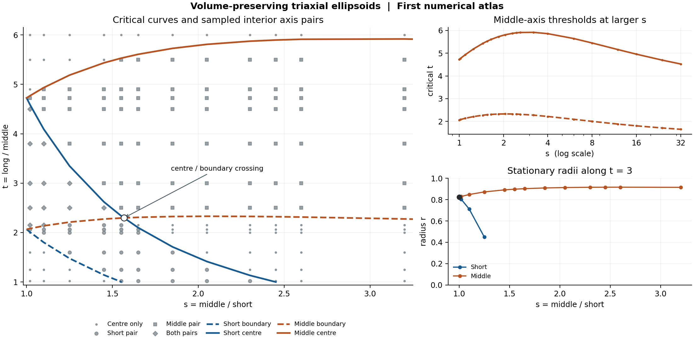

# 体積保存三軸楕円体の停留点 ―― 最初の地図と停留円の分裂

2026-11-20 ／ Codex → Judge ／ **DIAGNOSTIC_ONLY / NOT_EVIDENCE**  
研究対象は開球の内部停留点、および閉球へ内側から延長した全勾配の境界零。位置と Hessian は特記しない限り参照球座標で表す。

## 1　結論

**局所定理。** 扁長辺の \(t=3\) から \(s>1\) 側へ十分小さく動くと、内部停留点はちょうど5個ある。中心は指数0の極小。元の赤道停留円から短軸上に指数1の対、中間軸上に指数2の対が生じる。境界の全勾配は零を持たない。同じ結論は \(t=3\) のある開近傍でも成り立つ。採用済みの回転族分類に、今回の摂動計算と一つの係数の外向き区間評価を加えた。近傍の幅は数値化していない（§4）。

**数値地図。** 主格子は \(1\le s\le3.2,\ 1\le t\le6\) の195形状。厳密な三軸形状168点では、非中心の軸上対を0組、1組、2組と数えた。長軸上に非中心の枝は見つからず、短軸と中間軸の両方に対がある形状が12点あった。短軸の中心・境界曲線は、扁長辺の臨界値から扁平辺の対応する臨界値へつながった。中間軸の2曲線は扁長辺から分かれ、どちらも折り返して \(s=32\) の断面まで続いた。これらの線の間を全域で分類する定理は未了である。

左の実線は中心固有値の零、破線は境界の全勾配の零。青は短軸、橙は中間軸。灰色の記号は各格子点で見つかった内部の軸上対を示す。曲線は求根した断面を線で結んだもの。右上は中間軸の遠方、右下は \(t=3\) の半径標本。黒点は回転対称辺の円の半径である。

## 2　幾何から積分へ

\(a_1\le a_2\le a_3,\ \prod a_i=1\)。\(s=a_2/a_1,\ t=a_3/a_2\) として、\(L=\mathrm{diag}(1,s,st)\)、体積を保つ行列は \(M=(s^2t)^{-1/3}L\)。物理点は \(p=Mq,\ |q|<1\)。元の定義は、境界点 \(x\)、外向き単位法線 \(n\)、弦と法線の角 \(\alpha\) に対する
\[
 E=\frac{1}{3\operatorname{Vol}(K)}
 \int_{\partial K}\alpha^2(x)\,(x-p)\cdot n(x)\,dA(x).
\]
\(x=M\xi\) と置くと \(n=M^{-T}\xi/|M^{-T}\xi|\)、\(dA=\det M\,|M^{-T}\xi|\,d\Omega\)。従って重みは \(k\,d\Omega/(4\pi)\) に等しい。\(M\) 全体のスカラー倍は角度を変えない。以下、\(\langle\ \rangle\) は確率球面平均、
\[
 A=L^TL,\quad A_i=L_{ii}^2,\quad v=\xi-q,\quad k=1-q\cdot\xi,\quad D=|Lv|,\quad S=\sqrt B=|L^{-T}\xi|,
 \quad u=Lv/D,\quad \gamma=k/(DS)=u\cdot n.
\]
よって \(E=\langle kF(\gamma)\rangle,\ F=\arccos^2\gamma\)。物理 Hessian は \(M^{-T}H_q M^{-1}\) で、慣性指数を保つ。三つの鏡映により中心は常に停留し、軸上では残り2成分が消える。第一八分体での軸・開面・一般点1個は、全空間では2・4・8個の軌道を表す。対称辺上の円は別に数える。

### 2.1　面積表示の勾配と Hessian

\[
 P=-F'=\frac{2\arccos\gamma}{\sqrt{1-\gamma^2}},\quad
 J=\gamma P-F,\quad K=\gamma^2P,\quad Q=2P+\gamma P',\quad
 b=L^Tu,\quad z=\xi-\gamma S b .
\]
\(P(1)=2,\ Q(1)=10/3\)。\(0\le\gamma\le1\) で全ての角度核は有界。\(dD=-b\cdot dq,\ d\gamma=-z\cdot dq/(DS)\)、\(db=-(A-bb^T)dq/D\) を代入すると
\[
 E_i=\langle \xi_i J-L_{ii}S u_i K\rangle,\qquad
 H_q=\left\langle\frac{P\gamma^2 S^2(A-bb^T)-Qzz^T}{DS}\right\rangle. \tag{1}
\]
第1式はそのまま内側からの境界トレース。接触点1点を除いて被積分式が連続であり、形のコンパクト集合上に一様な定数支配がある。第2式は内部で通常の微分により成立する。境界に近づいたときも行列被積分式は \(C/|\xi-q|\) 以下。\(q=r\omega,\ r\ge1/2\) なら \(|\xi-q|^2=(1-r)^2+r|\xi-\omega|^2\)。従って接触点の半径 \(\eta\) の球面キャップの積分は、\(q\) がその点に十分近いとき一様に \(O(\eta)\)。補集合では一様収束する。これは有限の形状帯での Hessian の内側トレースも与える。特異な半軸極限への一様性は仮定しない。

### 2.2　弦表示と中心の3積分

弦方向 \(e\in S^2,\ m=q\cdot e,\ d=\sqrt{1-|q|^2+m^2}\) とし、\(\sigma=\pm1\) に対して
\[
 \ell_\sigma=d-\sigma m,\quad \xi_\sigma=q+\sigma\ell_\sigma e,\quad C=e^TAe,\quad
 b_\sigma=\sigma Ae/\sqrt C,\quad S_\sigma=|L^{-T}\xi_\sigma|,\quad
 \gamma_\sigma=d/(\sqrt C\,S_\sigma),\quad
 z_\sigma=\xi_\sigma-\sigma d\,Ae/C .
\]
\(\xi_\sigma\cdot(\sigma e)=d,\ k=\ell_\sigma d,\ D=\ell_\sigma\sqrt C\)。球面積と弦方向の立体角の変換 \(d\Omega_\xi=(\ell_\sigma^2/d)d\Omega_e\) を (1) に適用すると、内部で
\[
 H_q=\left\langle\frac12\sum_{\sigma=\pm1}
 \frac{\ell_\sigma}{d\sqrt C S_\sigma}
 \left[
 P_\sigma\gamma_\sigma^2 S_\sigma^2(A-b_\sigma b_\sigma^T)
 -Q_\sigma z_\sigma z_\sigma^T\right]\right\rangle_e. \tag{2}
\]
境界で接線となる弦に \(d=0\) を直接代入しない。数値の境界求根には (1) の勾配を使った。

中心では \(w_i=e_i^2,\ \sum w_i=1,\ C=\sum A_j w_j,\ B=\sum w_j/A_j,\ \gamma=1/\sqrt{CB}\)。対角の3個を同じスカラー核で算出できる。
\[
 h_i=\left\langle
 \frac{(P/C)(A_i-A_i^2 w_i/C)-Qw_i(1-A_i/C)^2}{\sqrt{CB}}
 \right\rangle. \tag{3}
\]
平均は単体 \(w_1,w_2\ge0,\ w_1+w_2\le1\) 上で \(dw_1dw_2/(2\pi\sqrt{w_1w_2w_3})\)。完全三軸では二重積分で、差分は不要。重複軸があると、単軸方向の \(\mu\) を固定して同じ長さの2軸の \(w_i\) を \((1-\mu^2)/2\) に置換でき、\(\int_0^1d\mu\) の一次元積分に戻る。球では \(H(0)=4I/3\)。\(s=1\) は \(\lambda=t\)、\(t=1\) は軸の交換と相似により \(\lambda=1/s\)。この同値は中心だけでなく元の積分全体に成立する。

### 2.3　軸外候補を減らす角微分

\(q_i>0\) で \(G_i=E_i/q_i\) とする。内部の \(q_i=0\) では鏡映により \(G_i=\int_0^1 E_{ii}(q_1,\ldots,\theta q_i,\ldots)d\theta\) に延長できる。境界へは上記の連続性を使える。回転生成子 \(X_{ij}=q_i\partial_j-q_j\partial_i\) を使い、\(q\) と積分変数を同時に回すと \(k\) は一定である。\(D^2,B\) を微分するだけで
\[
 q_i q_j(G_j-G_i)
 =(A_j-A_i)\left\langle kP\gamma
 \left[\frac{v_i v_j}{D^2}-\frac{\xi_i\xi_j}{A_i A_j B}\right]\right\rangle . \tag{4}
\]
これは厳密な因数分解である。右辺の平均は各鏡映に対して \(q_i,q_j\) それぞれに奇。内部のコンパクト領域では2回の差分商の積分形で \(q_iq_j\) を取り除ける。(4) の括弧は点ごとの正値核ではない。全形状での順序予想には §5.4 の反例候補がある。

## 3　非区間の分岐地図

各軸に \(g_i(r)=E_i(re_i),\ b_i=g_i(1)\) を定義する。以下の表で \(C_i\) は \(h_i=0\)、\(B_i\) は \(b_i=0\) の曲線。\(B_i\) 上の \(\pm e_i\) は全勾配の零となる。軸に直交する2成分は対称性で恒等的に消える。辺 \(s=1\) では短・中の2表示は同じ赤道を指す。

### 3.1　形状断面での臨界値

表中は固定した \(s\) での \(t\)。空欄はその断面の探索範囲 \(1\le t\le12\) に符号変化がなかった場合。遠方は桁を減らした。

| \(s\) | \(B_1\) 短軸境界 | \(C_1\) 短軸中心 | \(B_2\) 中間軸境界 | \(C_2\) 中間軸中心 |
|---:|---:|---:|---:|---:|
| 1 | 2.065382 | 4.724383 | 2.065382 | 4.724383 |
| 1.02 | 2.008877 | 4.587373 | 2.081143 | 4.769024 |
| 1.25 | 1.477594 | 3.347876 | 2.211742 | 5.185693 |
| 1.55 | 1.005020 | 2.340160 | 2.293798 | 5.528491 |
| 1.65 | — | 2.098894 | 2.308166 | 5.607372 |
| 2.05 | — | 1.414329 | 2.330078 | 5.808891 |
| 2.45 | — | 1.001002 | 2.321237 | 5.896200 |
| 3.20 | — | — | 2.275714 | 5.917775 |
| 8 | — | — | 2.00293 | 5.45012 |
| 16 | — | — | 1.80565 | 4.95824 |
| 32 | — | — | 1.6534 | 4.5255 |

- \(B_1\) は扁長辺の \(\lambda_b^{pro}\) と扁平辺の \(s=1.5538910301\) を結ぶ。\(C_1\) は \(\lambda_c^{pro}\) と \(s=2.4512275558\) を結ぶ。後二者を \(\lambda=1/s\) に戻すと、それぞれ約0.64355、0.40796。短軸上の対は格子上で \(h_1>0,\ b_1<0\) のとき1組あった。
- \(B_2,C_2\) は同じ扁長の二つの臨界値から別方向へ進む。\(B_2\) の高さの局所最大候補は \((2.08237,2.33017)\)、\(C_2\) は \((2.93539,5.92327)\)。曲線の水平接線はパラメータ平面の特徴であり、そこに新しい空間的停留点の合体を観測したわけではない。中間軸の対は格子上で \(h_2>0,\ b_2<0\) のとき1組あった。
- \(C_1\) と \(B_2\) は \((1.56696852,2.29658595)\) 付近で交差した。中心の短軸固有値が消える事象と、中間軸端点の全勾配が消える事象が同じ形状で起きる。両者の空間的位置は異なる。
- 辺 \(t=1\) の扁平鞍対は短軸に続く。辺 \(s=1\) の扁長停留円が短・中の2対に解ける。主格子の厳密な三軸形状で見つかった軸上根の横固有値に符号反転はなく、これ以外の枝の分岐を検出しなかった。細い島、接するだけの重根、格子間の分岐は未排除。

主矩形の各臨界断面では、分岐の向きも別に測った（normal.csv）。中心曲線上で軸勾配の三次係数、すなわち $g_i(r)=h_ir+c_3r^3+O(r^5)$ の $c_3$ は標本範囲で約 −0.262〜−0.153。中心の正固有値側に対が出るピッチフォークと整合する。境界曲線上の片側半径微分 $g_i'(1)$ は約 −1.759〜−1.456。縦断面での $\partial_t b_i$ も負で、$t$ を増やすと境界から対が内部へ入る。$\partial_t h_i$ は負で、その先で対が中心へ戻る。扁平辺では $s$ を動かした。これらの数値微分と三次係数の符号を曲線の全点には拡張していない。

### 3.2　census と Morse 指数

主格子の形状辺は回転族の採用分類を使う。下表は辺を除いた168形状。列は実際に半径を求根した結果。中心では符号順 \((h_1,h_2,h_3)\) を示す。

| 中心の符号／指数 | 非中心の軸上対なし | 短軸の対のみ | 中間軸の対のみ | 両方の対 |
|---|---:|---:|---:|---:|
| \(+,+,+\) ／ 0 | 10 | 29 | 0 | 12 |
| \(-,+,+\) ／ 1 | 31 | 0 | 69 | 0 |
| \(-,-,+\) ／ 2 | 17 | 0 | 0 | 0 |

短軸上の正の根41個は全て Hessian の符号が \((-,+,+)\)。中間軸上の81個は全て \((-,-,+)\)。対の両端の指数は同じ。主格子全体で \(h_3\ge1.2765,\ b_3\ge0.2861\) を標本値として観測した。個々の形の固有値、半径、3個の対角 Hessian はそれぞれ shape_refined.csv と axis_refined.csv にある。辺上の零接固有値は指数に加えない。

| \(t=3\) の \(s\) | 短軸半径 | 短軸点の円接線方向 \(H_{22}\) | 中間軸半径 | 中間軸点の円接線方向 \(H_{11}\) |
|---:|---:|---:|---:|---:|
| 1 | 0.82393827 | 0（対称性） | 同じ円 | 0 |
| 1.0001 | 0.82384103 | +0.00011487 | 0.82396672 | −0.00011486 |
| 1.001 | 0.82296470 | +0.00114840 | 0.82422238 | −0.00114732 |
| 1.02 | 0.80394799 | +0.02284154 | 0.82943353 | −0.02241741 |

たとえば \((1.02,3)\) の中心固有値は約 \((0.25495,0.28167,2.23222)\)。この点自体の全域分類は数値診断である。§4の局所定理の「十分小さい」に0.02を代入できるという証明はしていない。

### 3.3　面・一般位置・境界

3つの開座標面および開八分体で、各168形状につき各層6初期値から能動成分 \(G_i\) の同時零を探索した。全4032開始。半径 \([.01,.99998]\)、角度 \([.012,\pi/2-.012]\) の有界最小二乗。中心・軸近傍に数値的に落ちるだけで零と数えることを避けた。この切り落としは証明を与えず、とくに軸に近い別枝を見落とし得る。境界は \(r=1\) に固定し、25の代表形状と6つの軸境界遷移形状で各開弧・開八分体を合わせて248開始。目的関数は全勾配の能動成分を各座標で割ったもの。接線成分だけの零は数えていない。

各形状・層の最小残差を与えた初回終点から次数40で再探索した。次はその全終点中の最小 \(\max_i|G_i|\)。根の除外下界ではない。

| 場所 | 開面12 | 開面13 | 開面23 | 開八分体123 |
|---|---:|---:|---:|---:|
| 内部 | 0.008975 | 0.286905 | 0.291178 | 0.291178 |
| 球面上の各開弧・開八分体 | 0.015836 | 0.286748 | 0.291265 | 0.291265 |

初回は22評価上限に内部401・境界2開始が達した。全ての開始で追加検査の閾値 \(10^{-3}\) に入った候補は0。再探索796件のうち18件も上限到達。未収束を排除判定に読み替えない。

さらに境界上で形状変数を一つ自由にし、開弧では「角度＋形状」の2方程式、開八分体では「2角度＋形状」の3方程式を解いた。固定する側は縦12・横14断面、可動側は主矩形の比1.02以上。全1040開始で各層260件。最小残差は順に0.013598、0.286748、0.291265、0.291265で、追加検査の閾値に届いた点は0、評価上限到達は5件だった（moving_boundary.csv）。軸外の境界遷移を直接探しても候補は得ていない。形状断面間と角度切り落とし部分を含めた網羅性は未証明。

## 4　最初の証明

### 4.1　球の近くと扁平鞍の継続（解析）

球では (3) から \(H(0)=4I/3\)。半径 \(\delta\) の小球を取り、形が球と十分近ければそこで Hessian の最小固有値に正の共通下界を持たせられる。鏡映により中心の勾配は零なので、この小球の停留点は中心だけ。残る閉環帯 \(\delta\le|q|\le1\) で球の全勾配は、採用済み分類により零を持たない。コンパクト性でそのノルムの最小値は正。(1) の勾配は形と位置について共同連続なので、その余裕は三軸のある形状近傍にも移る。従って球のある形状近傍全体で内部は中心の極小だけで、境界零は空。

同様に扁平辺の2臨界値の間の任意の固定形状では、中心と軸鞍2個は非退化で境界零がない。各点の陰関数定理と残る閉集合の勾配の余裕により、三軸側でも全3個が続く。各鞍の近くの根の一意性と二つの座標鏡映により、対は短軸にとどまり、指数1を保つ。いずれも近傍の存在定理である。

### 4.2　円を分ける係数（解析）

\(\epsilon=\log s\) とし \(t\) を固定する。扁長辺で \(L=\mathrm{diag}(1,1,t)\) からの対数変形は \(\beta=(0,1,1)\)。一般の対角対数変形では
\[
 \partial_\epsilon E
 =\left\langle kP\gamma\sum_i\beta_i(u_i^2-n_i^2)\right\rangle,\qquad n=L^{-T}\xi/S. \tag{5}
\]
これは \(k\) が一定、\(\partial_\epsilon\log\gamma=\sum\beta_i(n_i^2-u_i^2)\) による。軸対称辺の停留円 \(q=r_*(\cos\phi,\sin\phi,0)\) に (5) を制限する。テンソル \(\langle kP\gamma(uu^T-nn^T)\rangle\) は基準点 \(r_*e_1\) で対角で、円上では座標回転で移る。トレースは恒等的に零。従って角度依存は \(c_0+c\cos2\phi\) だけであり
\[
 c(r,t)=\tfrac12\left\langle kP\gamma
       \left[n_1^2-n_2^2-u_1^2+u_2^2\right]\right\rangle_{q=re_1,s=1}. \tag{6}
\]

停留円は半径方向と第3方向に非退化な Morse–Bott 鞍である。管状座標 \((r,\phi,q_3)\) で二つの法方向の勾配方程式を解く。円のコンパクト性と法 Hessian の可逆性により、一意な滑らかな解が円全周に存在する。第3鏡映と一意性より解は \(q_3=0\)。得られる角度関数は \(E_0+\epsilon(c_0+c\cos2\phi)+O(\epsilon^2)\)、剰余は \(C^2(S^1)\) で一様。円は内点にあり、角度核 \(F\) は \(\gamma=1\) でも滑らかなので、この展開で境界微分は要らない。法方程式を解いたことによる1次の付加項は、元の法勾配が零なので消える。

\(c\ne0\) なら1次の角微分 \(-2c\sin2\phi\) は単純零を4個持つ。各零近傍では微分の単調性、残る閉弧では絶対値の正の下界により、十分小さい正の \(\epsilon\) で零は4個のみ。鏡映により角度は正確に各座標軸方向である。\(c<0\) のとき短軸側の角二階微分は正、中間軸側は負。法 Hessian の慣性 \((1-,1+)\) に縮約 Hessian の符号を加えて指数1と2を得る（ブロック消去の慣性公式）。中心近傍は §4.1 と同じ議論、円と中心を除くコンパクトな残部は全勾配の余裕を使う。辺の境界零が空であることがここで必要となる。

### 4.3　\(t=3\) の係数の符号（外向き区間計算を含む証明）

一意な円の半径を、まず軸勾配 \(g_1\) の符号で挟む。次に半径帯の**全点**で (6) を評価した。下表は厳密な包含を保つ向きに表示桁を丸めた。未丸めの出力と余裕不足で細分化した段も ring_boxes.csv にある。

| 対象 | 評価領域 | 得られた包含 | 最終角度セル数 |
|---|---|---|---:|
| \(g_1\) | \(r=13/16\) | \([0.00184,\,0.01153]\) | \(4096\times2048\) |
| \(g_1\) | \(r=27/32\) | \([-0.02203,\,-0.00273]\) | \(2048\times1024\) |
| \(c(r,3)\) | \(208/256\le r\le216/256\) | \([-0.24035,\,-0.15276]\) | 各 \(256\times128\)、半径8区間 |

**再実装用の式。** \(\mu=\xi_1\in[-1,1]\)、\(w=\tan(\phi/2)\in[0,1]\) とする。残りの2成分は鏡映で象限に折り、\(Y=(1-\mu^2)[(1-w^2)/(1+w^2)]^2,\ Z=(1-\mu^2)[2w/(1+w^2)]^2\) と置く。\(Y=\xi_2^2,Z=\xi_3^2\)。
\[
 D^2=(\mu-r)^2+1-\mu^2+8Z,\quad B=1-8Z/9,\quad k=1-r\mu,\quad
 n_1^2-n_2^2=(\mu^2-Y)/B,\quad
 u_1^2-u_2^2=((\mu-r)^2-Y)/D^2 .
\]
平均測度は \((d\mu/2)\,4dw/[\pi(1+w^2)]\)。\(g_1\) の核は \(\mu J-(\mu-r)S\,K/D\)。\(D\ge1-r,\ B\ge1/9\) を併用した。

区間演算は IEEE 754 binary64 の四則、平方、平方根の各結果を両隣の表現可能値に広げる。リーマン和は各セル全域の包含に正の面積を掛け、二分木の各加算も外向きにする。元の表面積積分に変数変換したので \(\pi\) 以外の三角定数は不要。角度評価には \(z=(1-\gamma)/2\) と \(U(z)=\arcsin\sqrt z/\sqrt z\) を使う。
\[
 U(z)=\sum_{j=0}^{54}\frac{\binom{2j}{j}}{4^j(2j+1)}z^j+R,\quad
 0\le R\le2^{-54},\quad
 P=2U/\sqrt{1-z},\quad F=4zU^2 .
\]
\(0\le z\le1/2\) と係数 \(\le1\) が剰余上界を与える。両関数は \(z\) に非減少で、\(\gamma\) の刻み \(2^{-14}\) の両外端から包める。定数 \(\pi\) は \(333/106<\pi<355/113\) で包む。各セルの半径・角度の端点は二進有理数。台帳は等幅の全角度セルを分割数と整数端点で指定している。各角度セルを1行ずつ保存する方式ではなく、指定した格子全体を再生する。前提は通常の最近接丸め、正しく丸める基本演算、段階的アンダーフローを備えた NumPy/CPU である。

以上により \(c(r_*,3)<0\)。§4.2 が適用できる。さらに辺上で \(r_*(t)\) は \(t=3\) の近くで滑らかで、\(c\) は連続。\(t\) を十分小さな閉区間に制限すれば、法 Hessian の可逆性、残部の勾配の余裕、\(c<0\) を一様に保てる。**\(0<s-1<\eta,\ |t-3|<\delta\) を満たすある \(\eta,\delta>0\) で全5点**という主張が従う。区間の大きさを特定するには高次剰余の明示上界が必要。

## 5　地図の限界と無限遠

### 5.1　実行計画と精度

初回の固定記録は PLAN.md、SHA-256 は b6e9a83a92a63b2d7210288547f83bb2f4d6d5399ef09660350bc50623a456e9。初回は接触方向を極にした \(x=\sqrt{(1-\cos\theta)/2}\) の Gauss–Legendre と一様中点方位角を使い、各軸の11半径（中心・境界を含む）で符号変化を取り Brent 法で求根。中心は (1) を直接使用した。数値上の一様方位格子と中心での原点用フレームの精度は形状比に依存する。

初回40次と80次で、\(s=3.2\) の \(C_2\) の位置が約0.036も動いた。そこで結果を上書きせず PLAN_R2.md を追加固定した。軸上では軸を北極に置き、上記 \(x\) 積分を赤道で分割し、方位角は四象限の鏡映を用いた Gauss 積分へ変更。象限折りで保存される軸勾配・対角 Hessian だけを使用する。32次と64次で全195形状を再計算し、64次の半径根を96次で再求根した。主格子の中心・境界の全符号は初回と一致。全軸根の半径の64次対96次の最大差は \(1.57\times10^{-8}\)。縦断面の臨界 \(t\) の48次対96次の最大差は主範囲で \(5.76\times10^{-9}\)、\(s=32\) を含めると \(1.34\times10^{-4}\)。これらは求積誤差の厳密な上界ではない。

内部の4点でエネルギーの中央差分と勾配の最大差は \(7.1\times10^{-10}\) 未満、勾配の差分と面積 Hessian は \(1.6\times10^{-10}\) 未満、別に実装した弦 Hessian と面積 Hessian は \(8.5\times10^{-14}\) 未満だった。主格子には球、4臨界値を挟む形状、両方の対が同時に現れる領域を含めた。個別の固有値を中心・非中心ともに保存してある。

### 5.2　無限遠で一様にいえること（解析）

\(\kappa=a_3/a_1=st\)。\(|q|\le1\) の全てで \(S\ge|\xi_1|,\ D\ge\kappa|\xi_3-q_3|\)。\(0<d\le1\) とし、\(|\xi_1|<d\) または \(|\xi_3-q_3|<d\) の球面確率は高々 \(2d\)（各座標の周辺分布は \([-1,1]\) 上一様）。補集合では \(\gamma\le2/(\kappa d^2)\)。さらに \(0\le\pi^2/4-F(\gamma)\le\pi\arcsin\gamma\le(\pi^2/2)\gamma\)、\(k\le2,\langle k\rangle=1\)。従って
\[
 0\le\pi^2/4-E(q)\le\pi^2 d+2\pi^2/(\kappa d^2)
 \le 3\pi^2\kappa^{-1/3}\quad(d=\kappa^{-1/3}).
\]
これは \(s,t\) が同時に発散する経路を含む、一様な**エネルギー**の極限である。小さい勾配の符号や零点の極限を取り出すには、次項とその微分の一様剰余が必要になる。

### 5.3　無限遠への数値断面

\(s=1,1.25,2,\ t=8,16,32\) の9点の中心符号は \((-,-,+)\)。\(s=8,16,32,\ t=1,1.5,3\) の9点では \((-,+,+)\)。後者の \(t=3\) では \(b_2<0<h_2\) のまま \(s=32\) まで届く。板状極限でも中間軸枝が残る可能性を示す。例えば \((32,3)\) で \((h_2,b_2)=(0.0465,-0.0468)\)、\((1.25,32)\) で \((-0.1477,-0.1892)\)。18点の6量の128次対256次の最大差は \(4.2\times10^{-6}\)。\(B_2,C_2\) の \(s\to\infty\) での極限値も、全形状についての枝数も決まっていない。

### 5.4　大域証明を左右する負の数値結果

主格子の厳密三軸形について3面の等角方向と八分体内の2方向、半径4個で \(G_i\) を調べた。各比較2016個で \(G_2-G_1,\ G_3-G_1,\ G_3-G_2\) の標本最小はそれぞれ \(0.00517,0.06986,0.02844\)。\(G_3\) 自体も、調べた能動点は全て正で標本最小は0.33428だった。

一方、**全形状で \(G_1<G_2<G_3\) と仮定する設計は支持されない。** \((s,t)=(1.25,32),\ q=r(1,2,3)/\sqrt{14}\) で \(r=.97\) の \(G_2-G_1\) は \(+0.000685\) 付近、\(r=.99\) で \(-0.000120\)、境界では \(-0.00055703\)。境界の \(G_3\) は \(+0.48061\)。320、480次の接触軸求積と (4) の固定フレーム求積で逆符号を再確認した。480次で境界の2表示の値は \(-0.0005570335,\,-0.0005570074\)。これは非区間の反例候補であり、順序の逆転点は停留点を意味しない。第3成分だけで除外できる領域にまで短・中の順序を要求する必要はない。

## 6　定理化の設計と費用

1. **円の分裂を独立照合。** 最初は \(t=3\) の (6)、両端の軸勾配、法指数を対象にする。絶対値の小さい全勾配を3次元で直接追う必要はない。次に \(t\) をコンパクトな円存在帯に分け、単純半径根と \(c<0\) を一緒に囲う。両端の \(r=0,1\) は別の標準形へ渡す。\(r\to0\) では角度係数自体が消えるため \(c/r^2\) 等に正規化する。
2. **開八分体から面へ。** 長軸について \(G_3>0\) をまず狙う。鏡映積分、(2) の正射影項と負の二乗項、形状の尾でのスケーリングを使う。領域ごとに \(G_3>0\) またはいずれかの \(G_i\ne0\) を示せばよい。残りを面12へ落とせれば、そこでだけ (4) の \((G_2-G_1)/(A_2-A_1)\) の下界、または同時零排除を調べる。分裂辺の近くでは (6) を使う。これらは未証明の補題候補であり、5変数被覆を正当化するための仮定にしない。
3. **軸根数。** \(x=r^2,\ U_i(x)=g_i(\sqrt x)/\sqrt x,\ U_i(0)=h_i,\ U_i(1)=b_i\)。まず零候補に限り \(\partial_x U_i<0\) を囲う。全ての零が単純な下向き横断なら、連続性により1軸の零は高々1個。両端の符号を組み合わせれば数・向きが出る。中心では偶 Taylor 係数、外端では (1) の全トレースと片側勾配を使う。根上で横固有値の符号も同時に囲う。これが軸から開面への二次分岐の検査になる。
4. **形状平面。** 中心と境界の各関数を別々に囲い、符号が確定しない細い帯だけをパラメータ付き区間 Newton に渡す。通常は \(t\) 方向の陰関数を使い、扁平辺の端では \(s\) 方向も選べる。高さの極大候補は \(F=\partial_s F=0\)、交差は \(h_1=b_2=0\) の2変数系として分離する。交差の近くで中心と端点を同じ空間零の箱に入れない。境界の軸外曲線を直接追うなら形状1変数も自由にし、全勾配の必要成分数を保持する。
5. **無限遠。** 針状側は \(\xi_3=q_3\)、板状側は \(\xi_1=0\) の層を別座標にする。§5.2 の2層の外側と交差部を分けた上で、勾配または面12の角微分の先頭係数を求める。回転辺での凹性・鏡映補題は、重複軸に依存した等式と有限の形状一様余裕を区別して移す。\(s,t\) が同時に大きい角は別の二尺度極限になる。

**見積もり。** 以下は主矩形の設計予算で、解析補題の成立を前提にした数量である。区間計算の実績は §4.3 の一点だけ。数値地図から区間実行時間を外挿する精度は低い。

| 工程 | 箱・セルの見積もり | 時間の目安と前提 |
|---|---:|---|
| \(t=3\) の符号再生 | 最終リーマン和で角度セル 10,747,904 個（前段の再分割分は別） | 同梱実装の全段再生は本環境で約7秒、1プロセス |
| 4臨界曲線の追跡 | 各128断面 × 4曲線 × 2〜8細分で約1千〜4千形状箱 | 1箱 0.1〜2秒と仮定して約2分〜2.3 CPU時間。独立実装で最初の32箱を測る |
| 軸枝の符号・指数 | 128断面 × 2軸 × 16半径帯 × 2〜8細分で約8千〜3.3万箱 | 同仮定で約0.2〜18 CPU時間。中心四次と境界カラーの解析部を先に用意 |
| 面12と遷移カラー | 約1万〜10万の残余箱を仮置き | 1箱 0.2〜5秒なら約0.6〜139 CPU時間。角積分セル数・包絡幅に最も敏感 |
| 一般位置と二尺度の尾 | 解析による次元削減の成否が先決 | \(G_3\) または代替成分の符号を得るまで、全域の箱数・完了時間は見積不能 |

CPU時間は並列台数で単純に割れるとの保証を含まない。位置3変数と形状2変数を各64分割すると積分前に \(64^5>10^9\) 箱になる。主な研究リスクは、長軸成分の排除を境界層にも移せるか、そして面12で残る符号を辺の軸対称極限と両立させられるかにある。

## 7　再現・監査と Judge の選択

ZIPを展開し、本書と同じディレクトリで次を実行する。Python 3.12.14、NumPy 2.3.5、SciPy 1.17.0、pandas 2.2.3、Matplotlib 3.10.8、GCC 14.2.0 の Linux x86-64 が本走環境。乱数は使わない。

~~~sh
sha256sum -c MANIFEST.sha256
./reproduce.sh
~~~

スクリプトは新しい一時ディレクトリで C 核をコンパイルし、全段を再走し、各CSVを配布時の値とバイト比較する。同一環境で別ディレクトリからの再走で全CSVが一致した。版の異なる数学ライブラリ・コンパイラでは最終ビットや数値最小化の停止位置が変わり得る。再走先を表示するので、異なる環境では差異の場所、角度次数、残差を確認できる。

| 参照先 | 内容 |
|---|---|
| PLAN.md、PLAN_R2.md、PLAN_R3.md、PLAN_R4.md、PLAN_R5.md、PLAN_R6.md と個別 .sha256 | 初回計画、粗求積の修正、区間符号、遠方の逆転、形状も動かす境界探索、臨界点の分岐方向。各段階を計算前に固定。後段の計画は前段の結果を見て作った |
| code/kernel.c、common.py、map.py、mixed.py | 面積核、粗地図、軸・開面・一般位置・境界探索 |
| code/refine.py、checks.py、torque.py、reversal.py | 象限折り求積、弦式と差分との照合、成分順序と逆転の検査 |
| code/moving_boundary.py、normal.py と同名に対応する出力 | 形状を自由にした境界候補探索と、各臨界断面の局所係数 |
| code/ring_interval.py、out/ring_boxes.csv | 局所定理の独立再計算に必要な区間核、分割規則、余裕不足段を含む台帳 |
| out/shape_refined.csv、axis_refined.csv、sections.csv、special.csv、split.csv | 主地図の中心・境界・軸根・臨界断面・交差・分裂。軸番号は1始まり |
| out/mixed.csv、mixed_recheck.csv、ordering.csv、torque.csv、reversal.csv、rays.csv | 全初期値と終点、残差、停止状態、角微分の診断、無限遠への断面 |
| out/shape.csv、radial_samples.csv、axis.csv、curves.csv、derivative_check.csv | 初回走査と2方向の形状断面、導関数照合。初回の粗い根も保存 |
| REPLAY.txt、MANIFEST.sha256 | 別ディレクトリの実測再走と同梱物のファイル単位 SHA-256 |

**参照した前提。** 回転族の最終裁定の文書は commit 6b1bc9efcef7aecae5cbec251e8e71479ef2c203。元の物理定義は ORIGINAL_DEFINITIONS_INPUT_PACK_V2.md §1、回転族の勾配規約は CODEX_D_OB_FULL_FAMILY_20261119.md §1 と照合した。今回の三軸の数値・区間計算はこの作業環境で行った。[回転族の裁定原文](https://github.com/cotaxxxx/bg-spheroid-family/blob/6b1bc9efcef7aecae5cbec251e8e71479ef2c203/runs/2026-11-20/D_OB_RIM_LAYER_CODEX_AUDIT_V54/JUDGE_RULING_ROTATIONAL_FAMILY_COMPLETE_20261120.md)

| Judge の選択肢 | 対象と得られる判断 |
|---|---|
| **A　局所定理を先に独立監査（推奨）** | Readerの三軸拡張の最小受入例を §4.3 にする。元の物理積分から (6) の係数・符号・指数割当を独立に再現し、球近傍の補題と併せて論文IIの最初の定理を判断できる |
| B　有限矩形の地図を先に定理化 | まず \(G_3\) と面12の角差商を32形状箱で較正。実測した余裕・箱幅で大域計算の予算を決める |
| C　無限遠の解析を先行 | §5.4 の逆転を区間で検証し、尾で必要な層と局所不等式を選定。有限格子だけでは決められない漸近枝を優先する |

今回の提出単位は「局所定理と、監査可能な最初の非区間地図」である。全象限の根数一意性、非軸枝の大域排除、境界零曲線の網羅、無限遠の臨界値は、次段の証明課題として残る。
