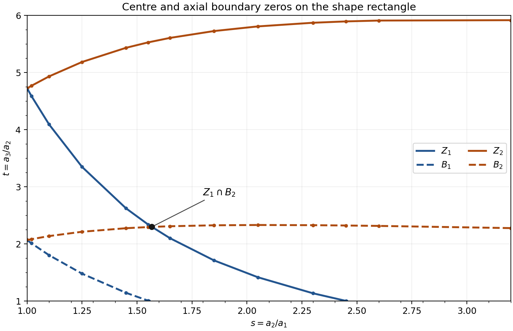

# 三軸楕円体の主矩形 ―― 四つの零曲線と、停留点を分類できた帯

2026-11-20　Codex → Judge　**DIAGNOSTIC_ONLY / NOT_EVIDENCE**  
対象は参照球の内部停留点と、内側から延長した全勾配の境界零。形状領域は \(R=[1,16/5]\times[1,6]\)。V55 の地図と V56 の条件付き構造定理を基にした区間計算付きの研究報告。以下の新しい計算補題は独立監査前である。

## 1　どこまで決まったか

| 範囲 | 得られた結論 | 根拠 |
|---|---|---|
| 主矩形全体 | 中心の慣性指数と、短・中軸の境界端点が零になる形を決定。四つの零曲線は単純なグラフ。厳密な三軸領域での交点は \(Z_1\cap B_2\) 一つだけ | §3、数値証明付録 A |
| \(1<s\le 1+2^{-39},\ 2\le t\le5\) | **閉球の全零点を分類**。中心のほか、\(h_i>0>b_i\) の軸ごとに内部に一対。\(b_i=0\) ではその軸の境界端点に一対。短軸対は指数1、中間軸対は指数2 | §4、付録 B、194個の移送箱 |
| 球の近く \(\log(st)\le10^{-5}\) | 全球で中心のみ。非退化極小。境界零なし | §5 の解析評価 |
| 二つの回転辺の近く | 主矩形内には両辺に沿う正の幅の近傍があり、厳密な三軸部分では上の個数・指数則が成立。回転辺そのものでは採用済みの軸対・円の分類 | §6。一般の近傍幅は未算出 |
| \((1.02,3)\) を含む有理形状箱 | 両軸それぞれで全半径にわたる強い単調性 (HB)。内部の軸上対は各1組 | §4.4。箱全体での軸外排除は未確定 |
| これらから外れる内陸 | 四つの曲線から予想個数は読める。両軸上では \(h_i>0>b_i\) なら少なくとも一対。追加の軸上対、軸外の内部・境界零の排除は未了 | §7–8。初期較正に未決定箱あり |

**本報告で主矩形全体について言えるのは、四つのスカラー量の分類までである。** とくに \(h_3>0\) は中心での結論で、長軸方向の全位置での正値性 (H3) には別の証明が要る。

区間核の実装と解析剰余は[証明付録](PROOF_NUMERICS.md)、台帳の列と再実行環境は[再現手順](REPRODUCTION.md)を参照。

## 2　正規化と監査用の核

\(L=\mathrm{diag}(1,s,st),\ M=(s^2t)^{-1/3}L,\ A=L^TL\)。物理点は \(Mq\)。境界 \(M\xi\) の面素 \(\det M\,|M^{-T}\xi|d\Omega\) と、弦の外向き法線成分を掛けると、正規化した錐体体積の測度は \(k\,d\Omega/(4\pi)\) となる。\(v=\xi-q,\ k=1-q\cdot\xi,\ D=|Lv|,\ S=|L^{-T}\xi|,\ n=L^{-T}\xi/S,\ u=Lv/D,\ g=u\cdot n=k/(DS)\)。エネルギーは \(E=\langle k F(g)\rangle,\ F=\arccos^2g,\ P=-F',\ Q=2P+gP'\)。ここで平均は確率球面平均。形の相似は角度と停留点の慣性指数を保つ。

\(b=L^Tu,\ z=\xi-gSb\) と置く。この段落のベクトル \(b\) と次節の軸端スカラー \(b_i\) を区別する。\(dg=-z\cdot dq/(DS),\ db=-(A-bb^T)dq/D\) により
\[
 \nabla E=\langle \xi(gP-F)-Sb\,g^2P\rangle,\qquad
 H=\left\langle{Pg^2S^2(A-bb^T)-Qzz^T\over DS}\right\rangle.\tag{1}
\]
第1式は有界、第2式はコンパクト形状集合で \(C/|\xi-q|\) に支配される。\(|\xi-r\omega|^2=(1-r)^2+r|\xi-\omega|^2\) より、接触点の半径 \(\eta\) の帽子の積分は一様に \(O(\eta)\)。従って閉球に連続な内側トレースがある。境界零の判定はこの三成分すべてに対して行う。

\(W_i=E_i/q_i\) は鏡映により \(E_{ii}\) の座標線分平均に延長できる。両座標を一緒に回すと \(k\) が不変で、角微分は
\[
 W_2-W_1=(s-1/s)C_{12},\qquad C_{12}=T_{12}/(q_1q_2),\qquad
 T=\langle kgP(uu^T-nn^T)\rangle.\tag{2}
\]
比は鏡映による二重の積分差商で延長する。\(s=1\) での計算に \((s-1)^{-1}\) を使わない。回転対称なら赤道面の半径 \(r\) に対して \(C_{12}=(T_{11}-T_{22})(re_1)/r^2\) となる。

## 3　層 IV の結果 ―― 主矩形全域

\(h_i=E_{ii}(0),\ \kappa_i(r)=E_i(re_i)/r,\ \kappa_i(0)=h_i,\ b_i=\kappa_i(1)\)。\(Z_i=\{h_i=0\},\ B_i=\{b_i=0\}\)。各グラフの下側で対応する量は正、上側で負。短軸曲線が下辺に達した後の縦断面では、その量は全体で負になる。グラフ上ではゼロである。境界端点 \(\pm e_i\) の残りの勾配成分は鏡映で消える。

| 曲線 | 左辺 \(s=1\) の高さ | もう一端 | \(t\) 方向 |
|---|---:|---|---|
| \(B_1\) | 約 2.065382 | 下辺 \(s\simeq1.553891\) | 零点で導関数負 |
| \(Z_1\) | 約 4.724383 | 下辺 \(s\simeq2.451228\) | 同上 |
| \(B_2\) | 約 2.065382 | 右辺 \(t\simeq2.275714\) | 同上 |
| \(Z_2\) | 約 4.724383 | 右辺 \(t\simeq5.917775\) | 同上 |

近似値は V55 の断面値。グラフであること、交点数、横断性は今回の区間評価に基づく。上辺は四量とも負。下辺では \(h_2,b_2>0\) で、\(h_1,b_1\) の零候補箱は \(s\) 微分が負。したがって単純零は辺にも横断する。\(t\) の関数値を \(s\) に対して単調とは仮定しない。

全域で \(h_3>0.6714\)、また \(h_2-h_1\ge(s-1/s)/32\)。後者は284箱で直接、残り23箱は左辺での等号と \(\partial_s(h_2-h_1)>1/16\) から得た。従って中心で \(C_{12}\ge1/32\)。厳密な三軸では中心の指数は \(h_1>0\) なら0、\(h_1<0<h_2\) なら1、\(h_2<0\) なら2。\(Z_1,Z_2\) 上では核はそれぞれ一次元で、負固有値数は順に0、1である。

\(B_1\) 上で \(h_1>0\)、\(B_2\) 上で \(h_2>0\)、\(s>1\) の \(B_1\) 上で \(b_2>0\)。最後は左辺の \(b_2=b_1\) からの差の積分も使う。これと中心の順序から可能な内部交点は一種類に絞れる。\(B_2\) に沿う \(h_1\) の零候補で
\[
 \Delta=h_{1,s}b_{2,t}-h_{1,t}b_{2,s}>0.02989.
\]
従ってグラフに沿う導関数 \(\Delta/b_{2,t}\) は負。候補外は \(h_1\) または \(b_2\) が非零で、同一グラフ上に二つ目の下向き交差は存在できない。存在は中心 \((1.566969,2.296586)\)、各半幅 \(10^{-3}\) の正方形上の Krawczyk 包含で得た。最大行和は0.582275未満、像は \([1.56647835,1.56745906]\times[2.29598485,2.29718715]\) の中にある。整数・有理数での再検査は `out/cross.csv` と `out/kraw.txt`。さらに角度2048で中心残差を包み直し、同じ区間行列で32回交差を取ると、交点は **[1.566967567136, 1.566969483971] × [2.296584862724, 2.296587050977]** に入る。右辺の根は符号を両端で分離して、\(B_2\) は \(2.275<t<2.277\)、\(Z_2\) は \(5.917<t<5.919\) と包んだ。これは上下関係とグラフ一意性を併用した区間である。



図の線は V55 の非区間断面を結び、黒点は今回区間で分離した交点を表す。線幅は誤差を表さない。

この二重事象では中心と中間軸の端点という異なる位置で零が同時に起きる。

## 4　層 I・II・III をつないだ明示帯

### 4.1　赤道面の外を除く

形の対数ひずみを \(\epsilon\) とする。対角成分の対数速度は \([0,1]\)、軸長は \([1,K]\) とする。\(\|u'\|,\|n'\|\le1,\ |g'|\le2,\ |S'|\le S,\ |b'|\le2K,\ |z'|\le5K\)。プライムはここでは形微分。付録の積分表示から \(|P|,|P_g|\le\pi,\ |P_{gg}|\le2\pi\)。式 (1) で射影 \(A-bb^T\) のノルムは \(K^2\)、その導関数は \(4K^2\) 以下。分母の逆数の対数微分は絶対値2以下。積の微分を項別に取ると
\[
 \|\partial_\epsilon H\|\le
 K\pi[14K^2+16(1+K)^2+30K(1+K)]
 \left\langle |\xi-q|^{-1}\right\rangle.\tag{3}
\]
最後の平均は \(\mu=\xi\cdot q/|q|\) の直接積分で閉球全体で1。\(K=6\) で右辺は 50000 未満。\(L=(1,s,st)\) を固定 \(t\) で左辺から動かすと \(\epsilon=\log s\)。座標線分平均にも同じノルム評価を使える。V50 (5)、V51 の境界延長は \(2\le t\le5\) で \(W_3(1,t,q)\ge3341881/2^{36}\)。従って明示帯では \(W_3\ge3341881/2^{36}-50000\,2^{-39}>0\)、境界も含む。

### 4.2　閉じた赤道円板で二軸を分ける

左辺で \(\tau(r,t)=(T_{11}-T_{22})(re_1)\)。\(\tau(0)=\tau'(0)=0\)。\(0\le r\le3/8\) の555箱で \(\tau''\ge0.00122408\)、\(3/8\le r\le1\) の897箱で \(\tau\ge0.00018254\)。どの箱も \(2\le t\le5\) の対応部分を覆う。二回積分して、左辺の円板全体で \(C_{12}>0.00018\)。付録 B の複素微分評価により \(|\partial_\epsilon C_{12}|\le41943040\)。従って明示帯の閉円板でも \(C_{12}>0.00010\)。これにより境界円のうち軸端以外を除ける。

### 4.3　赤道上の根を両端まで数える

V50 の E00〜E11 の186終端は \([2,5]\times[0,1]\) を覆う。左辺で正の \(\kappa\)、負の半径 Hessian、または負の \(\kappa'/r=E_{yyyy}/3\) のいずれかを与える。三軸化後の両軸で同じ符号を使えることを、各箱で元の余裕と摂動量を比較して確かめた。後者の式の等号は回転辺で使う。\(r\to0\) の変化量は付録 B の四階評価で扱う。

| 三軸化後の指標 | 箱数 | 全移送後の片側余裕の下界 |
|---|---:|---:|
| \(\kappa_i>0\) | 39 | 0.0016112 |
| \(E_{ii}<0\) | 62 | 0.0008867 |
| \(\kappa_i'/r<0,\ r\ge1/32\) | 85 | 0.0005324 |
| \(\kappa_i'/r<0,\ r\le1/32\)（延長値も含む） | 8 | 0.1817 |

内部の正半径の根では傾きが必ず負。中心では \(h_i=0\) のとき傾きの正規化値が負で、直後に \(\kappa_i<0\)。境界端点が根のとき直前では正となる。従って内部対は \(h_i>0>b_i\) の場合に限り一対、境界対は \(b_i=0\) の場合に限り一対。軸上零で Hessian は対角。半径方向は負、第三方向は正、もう一方の赤道方向は (2) により短軸で正、中間軸で負となる。境界端点の指数は内側 Hessian の負固有値数を指す。中心の退化時は §3 の核次元を併記する。

より具体的に、明示帯の **\(17/8\le t\le9/2\) では内部はちょうど5点**（中心は極小、短軸の二点は指数1、中間軸の二点は指数2）で、境界零はない。\(t=17/8\) で両 \(b_i<-0.0000498\)、\(t=9/2\) で両 \(h_i>0.00799\) を直接区間で確かめた。零曲線の下向き単純性で中間の全 \(t\) に及ぶ。\(t=2\) では両 \(b_i>0.001915\)、\(t=5\) では両 \(h_i<-0.00902\) で、いずれも中心のみ。中心の指数は順に0、2。形状箱・試行次数・全区間は `out/census.csv` にある。

厳密な三軸のこの帯で \(t\) を2から5へ上げると、曲線の順序は \(B_1,B_2,Z_1,Z_2\)。境界曲線間の順序は \(B_1\) 上の \(b_2>0\)、中心曲線間は \(h_2>h_1\)、中央の間隔は上の5点帯から従う。四つの開いた臨界値間とその外側を順に通ると、内部の総数は **1、3、5、3、1** と変わる。境界曲線上では当該対がちょうど端点にあり、中心曲線上では当該対が中心に合流している。

移送とは別に \(1\le s\le1+1/5242880,\ 2\le t\le7/2\) では、6050箱で上記の両軸の根の個数則を直接検査した。この広い帯で、軸外まで排除するためには別途 (H3),(H12) が必要である。

### 4.4　辺から離れた一つの箱で強い (HB)

整数単位を \(1/5242880\) とし、形状箱を \([5347722,5347754]\times[15728624,15728656]\) とした。\(r\le21/64\) では四階方向微分が負、残る半径では \(\kappa_i'/r<0\) を直接包む。補充した40箱は `bridge.csv`。根は短軸でおよそ \((0.75,0.85)\)、中間軸でおよそ \((0.78,0.88)\) の間にあり、正確な端点は `edge.csv` の plus/minus 行。層 III そのものをこの形状箱の全半径で示せた。

## 5　球の近くの明示的評価

球で \(q=re_3,\ \mu=\xi_3\)。\(F\) に掛かる \(-\mu\) の項を球面の一変数積分で部分積分すると
\[
 E'(r)/r=\left\langle{(1-\mu^2)P(g)(2-r\mu-r^2)\over2(1-2r\mu+r^2)^{3/2}}\right\rangle.
\]
全体の被積分関数 は非負。\(\mu\le0\) の半分のみを取り、\(P\ge2,D\le2\) を使うと \(W_i\ge1/24\)。端点へは連続延長する。球から目的形へ各対数半軸を直線で動かし、\(\epsilon=\log(st)\) を時間に取る。(3) は \(K=2\) で2500未満なので、\(\epsilon\le10^{-5}\) なら全 \(i,q\) で \(W_i\ge1/24-0.025>0\)。これで中心以外の全勾配零を除く。

## 6　両回転辺での接続

扁長辺の円の存在帯の閉じた部分では、法線 Hessian は半径負・鉛直正である。赤道円板の \(C_{12}\) の下界は臨界値を含む。中心合流では回転解の赤道四次が負なので、近傍の両軸でも四階方向微分が負。境界合流では \(q=e_1,s=1,t\in[2.06,2.07]\) の片側 Hessian で \(H_{11}<-1.247, H_{33}>0.9039\)（`rim.csv` の実際の整数区間は両端を外へ丸めたもの）。円に沿って回して同じ結論を得る。帯の外で中心以外に零がない点は、非退化中心と、残りの閉集合上の勾配ノルムの正の最小値により形摂動で保存される。

扁平辺では既採用の短軸対は非退化で、鏡映と陰関数定理により軸上に続く。中心臨界では短軸四次が負で、横二方向が正。境界臨界では \(t=1,\ s\in[1.55,1.56]\) の \(q=e_1\) で \(H_{11}<-1.201,\ H_{22},H_{33}>0.4748\)。連続性により横の二次形式は端点近傍で正定値。軸への直交射影から観測点までの線分で横勾配を積分すると、その線分が閉球内にあるので軸外零を除ける。短軸上では中心の四次負、または外端の半径二次負で根を数える。近傍の残部にはコンパクト性を使う。各回転辺の有限区間をこれらの開近傍で覆えば、両辺に沿う正の幅が存在する。\(s=1\) の円そのものは半径負・鉛直正・接線零の Morse–Bott 集合として数える。

## 7　主矩形全体での中心近傍と長軸の排除

全形状で長軸の両端点は零にならない。端点専用の141箱で \(b_3>0.0000222\)。さらに軸の外側 \(11/16\le |r|\le1\) は273箱で \(E_3(re_3)/r>0.0002149\)。この下界と Hessian の一様上界により、\(|q_3|\ge11/16,\sqrt{q_1^2+q_2^2}\le2^{-30}\) の円筒内では、境界の小さな帽子も含めて零がない。全半径を試した2685箱のうち1727箱は直接法で未決定だった。

中心では全形状共通の半径も取れる。\(|q|\le2^{-16}\) で \(W_3>0.51\)。赤道の \(\max(|q_1|,|q_2|)\le2^{-20}\) では \(C_{12}>0.016\)。したがって厳密な三軸では、半径 \(2^{-20}\) の中の零は中心、短軸、中間軸に限られる。根の個数の全域一意性は引き続き層 III の課題である。二つの Cauchy 評価と長軸の区間核は証明付録 C に示した。

## 8　較正、残る位置、計算予算

**非区間の探索。** V55 の195形、両軸、7半径の2730個の傾き標本はすべて負。64点則で零に最も近い標本は \((s,t,i,r)=(3.2,6,1,0.025)\) の約 \(-0.000381\)。この標本を含め有限点の符号で (HB) 全域を結論しない。

**区間較正。** 形を4×8等分、各形状箱に位置幅1/512の8パッチを取った。第一八分体、面13・23、赤道直近、面13の極限境界、および赤道円板の内側2点と境界弧を含む。端のパッチは箱と閉球の共通部分を意味する。 `cal.csv` は符号が出なかった行も含む571行である。

| 量 | 元の32箱、角度16 | 各箱中央の幅1/64、角度64 | 未決定のうち優先して角度256で試したもの |
|---|---:|---:|---:|
| 層 I、\(E_3/q_3\) 直接 | 0/128 | 110/128 | 6/6 |
| 層 I、赤道直近の \(H_{33}\) | 0/32 | 5/32 | 14/21 |
| 層 II、\(T_{12}/(q_1q_2)\) | 0/96 | 21/96 | 32/32 |

分子は区間下端が正になった件数。中央の開八分体パッチと第一の赤道円板パッチはそれぞれ32形状すべてで正。これらの32個の微小形状箱の間には間隔がある。全571件の計算時間は15.0 CPU秒。層 III は同じ32の微小形状箱で両軸・中心近傍・中間半径・外端の192試行中62件で強い負の傾き指標を分離できた。未決定130件は反例を与えない。

| 層 | 同じ幅で直接被覆する場合の規模 | 実測からの外挿と次に使う方法 |
|---|---|---|
| I | 形131072箱 × 球八分体約7030万箱、約 \(9.2\times10^{12}\) | 角度256の1箱約0.075–0.184 CPU秒で約2.2万–5.4万 CPU年。赤道近傍は \(H_{33}\) の線分平均、接触は弦の対と帽子評価、残りは形のスペクトル近似へ |
| II | 同じ形 × 円板四分域約20.6万箱、約 \(2.7\times10^{10}\) | 1箱約0.015–0.232 CPU秒を当てると約13–199 CPU年。軸沿いは二重差商を解析的に消去、先に円板の境界と中心を押さえる |
| III | 半径を1024分割すれば両軸約2.68億箱 | 1箱0.0167 CPU秒でも約52 CPU日。高解像度・四階項で増える。符号が既知の箱を飛ばす根候補専用の判定と V50 からの移送を優先 |
| IV | 節点12513、中心と各辺の終端1609、直接境界被覆および交差点 | 節点615 CPU秒、初回直接被覆79秒、境界補充15秒、最初の2変数局所分離124秒。計算済み。再監査は一番弱い符号と節点から可能 |

独立な非区間検算では、元のスカラー密度を軸方向に二回微分し、C++ の区間核を読み込まずに Gauss–Legendre 則で評価した。節点9形×3成分と右辺の符号4件の合計31件で、384点則の値はすべて対応する区間に入った。192点則との最大差は \(6.88\times10^{-12}\) 以下。この検算は求積剰余の証明を担わない。

これらは被覆完成の上限ではない。境界パッチの一部では上の幅でも符号が出ておらず、必要な細分化はさらに増える。V54 の鏡映は軸回りの同じ長さを使う。三軸の (1) では射影の正項と \(Qzz^T\) の負項が同時に現れ、鏡映対だけから \(W_3>0\) は導けなかった。\(C_{13},C_{23}\) は差の符号を与えるが、それだけで三成分の共通零は排除できず、基準成分の符号または別の位置評価も要る。残る最大の対象は内陸における赤道直近・境界の層 I と、円板の軸沿い・境界の層 II。高次元の一様分割を本走に移す根拠は得ていない。

## 9　再現と Judge の選択

ZIP の `PROOF_NUMERICS.md` に区間核・解析剰余・移送定数を記した。展開したディレクトリで次を実行する。Linux x86-64、Python 3.12.14、NumPy 2.3.5、SciPy 1.17.0、GCC/G++ 14.2.0。計画ごとのハッシュは固定時点の内容を照合するもので、第三者タイムスタンプではない。

```sh
sha256sum -c MANIFEST.sha256
./reproduce.sh --check
JOBS=7 ./reproduce.sh
```

検査器はハッシュ、整数端点の被覆、符号、局所包含、採用済み辺からの余裕を検査する。同じ数値核の再実行と、別実装による積分の監査は別の工程である。値の台帳は `out/`、コードは `code/`。形・位置の既定の整数分母は5242880、交点と右端点の入力は1000000、移送元の形と半径は \(2^{20}\)。補充の優先順位、角度分割数、未決定条件は各段階の PLAN に残した。時間台帳はハードウェアと負荷に依存する。

1. **推奨案。** 層 IV と明示帯を二つの監査単位として先に照合する。層 IV は角度誤差、\(h_3\) の全域箱、\(Z_1\cap B_2\) の行列式と包含。明示帯は `disk.csv` の最弱2箱、(3)、V50 の移送194箱を優先する。その後、内陸で一つの細い形状帯について層 I・II の縮約を試す。
2. 別案は先に全域の軸上根数だけを求めること。層 III は位置が一次元で進めやすく、軸外零の有無は別課題として残る。
3. 直接の全次元被覆は上表の実測外挿の負担がある。今回の新しい区間結果を論文 II の根拠として採用するかどうかは Judge の独立照合後の判断に委ねる。
